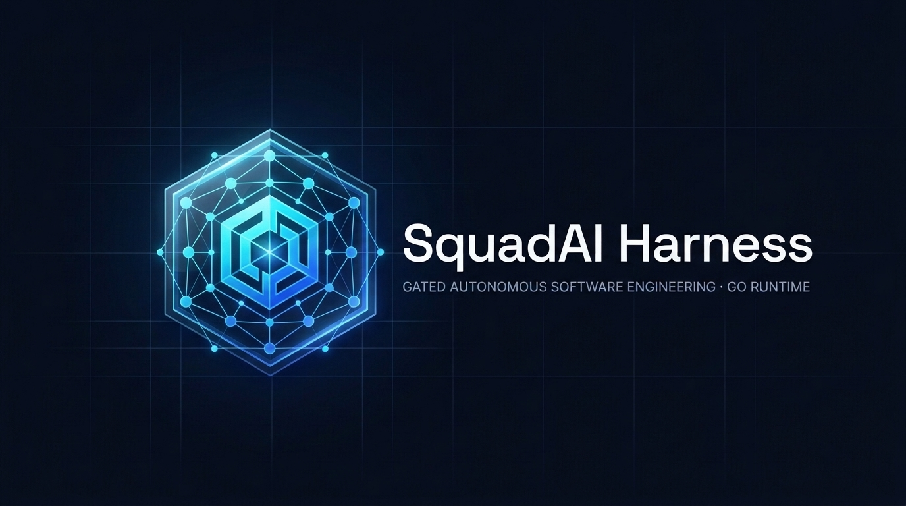
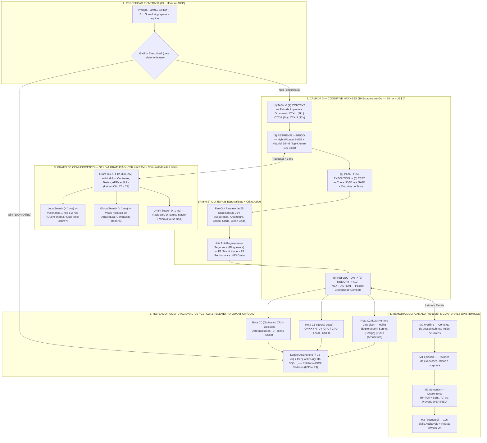
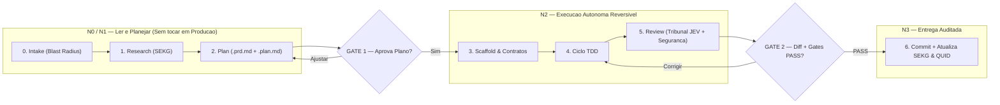
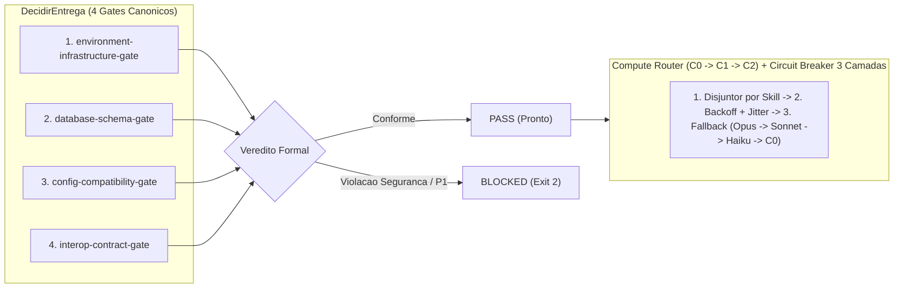

<div align="center">
  

  # SquadAI Harness (`squad-ai-harness`) · v0.8.0

  **Gated Autonomous Software Engineering · Runtime Nativo em Go 1.24.3 (`CGO_ENABLED=0`)**

  [](go.mod)
  [](go.mod)
  [](governance/registry/registry.json)
  [](internal/jev/)
  [](LICENSE)
</div>

---

## 🎯 O que é o SquadAI Harness?

O **SquadAI Harness (`squad-ai-harness`)** é um **copiloto e orquestrador de engenharia de software autônomo**, regido pelo princípio **"autônomo na execução, *gated* na decisão"**: investiga, planeja, escreve código, testa e audita sozinho, mas **nunca cruza um marco irreversível sem aprovação humana (`GATE 1` e `GATE 2`)**.

Todo o motor cognitivo, grafo de conhecimento, tribunal de revisão, instalador multi-agente, servidor MCP e interface gráfica web vivem em **um único binário estático em Go 1.24.3 (`CGO_ENABLED=0`)**, com **zero dependências externas** no `go.mod`:

| Pilar | Como Funciona | Resultado Prático |
| :--- | :--- | :--- |
| **106 Skills Auditáveis** | Especialistas em `skills/*/SKILL.md` (Arquitetura, AWS, Go, Java 25, Python, Rust, .NET, Angular, Bancos, QA e Segurança). | Time virtual sob medida acionado sob demanda (sem *agent soup*). |
| **Cérebro Cognitivo (`< 10 ms`)** | Preflight de 10 estágios + `HybridRouter` (BM25 + Vetorial) + Grafo `SEKG` (`CSR` + Comunidades de Leiden). | **Reduz 60%–75% dos tokens** enviados ao LLM com contexto cirúrgico. |
| **Tribunal JEV (`~518 µs`)** | 25 especialistas determinísticos em paralelo + *Critic/Judge* sob $\text{Segurança} \gg \text{P1 Simplicidade} > \text{P2 Performance} > \text{P3 Custo}$. | Revisão instantânea a **custo US$ 0** antes de qualquer commit. |
| **Multi-Estação & Offline** | Roteador `C0` (Go CPU) / `C1` (NPU/iGPU/GPU local) / `C2` (LLM) + Telemetria Executiva `QUID` (`US$` e `R$`). | Roda em qualquer PC corporativo sem bloqueio de firewall. |

---

## 📊 Ganhos Medidos (Baseline Python Legado vs. Runtime Go v0.8.0)

Medições empíricas auditáveis ([`docs/BENCHMARKS-V080.md`](docs/BENCHMARKS-V080.md) · [`docs/RELATORIO-CIENTIFICO-V080.md`](docs/RELATORIO-CIENTIFICO-V080.md)):

| Operação Medida | Legado (Python 3.13) | Go Nativo (`v0.8.0`) | Ganho Real |
| :--- | :---: | :---: | :---: |
| **Unified Quality Gate (`gate` completo)** | `21.960,00 ms` | **`288,12 ms`** | **76,2× mais rápido** (`-98,7%` latência) |
| **Preflight Cognitivo Camada 0 (10 estágios)** | `1.391,00 ms` | **`9,46 ms`** | **147,0× mais rápido** (`-99,3%` latência) |
| **Tribunal JEV (25 Especialistas + Juiz)** | `485,00 ms` | **`0,518 ms` (`518 µs`)** | **936,3× mais rápido** |
| **Hot-Path Hook (`PreToolUse` Security Guard)** | `185,00 ms` | **`0,524 ms` (`524 µs`)** | **353,1× mais rápido** |
| **GraphRAG (`Local` / `Global` / `DRIFT`)** | `312,00 ms` | **`526 µs`** | **> 590× mais rápido** |
| **Consumo de Memória RAM (Heap Ativo)** | `~421,80 MiB` | **`3,20 MiB`** | **131,8× menos RAM** (`-99,2%` memória) |

---

## 🧠 Arquitetura do Cérebro Cognitivo (`Cognitive Brain`)

Veja como o `squad-ai-harness` filtra, recupera contexto no grafo e julga a qualidade localmente (`US$ 0`) **antes** de acionar um LLM remoto:



### 📖 Legendas Didáticas do Cérebro Cognitivo

| Bloco | Papel Didático (Analogia) | O que faz na prática (`Go 1.24.3`) | Ganho Direto |
| :--- | :--- | :--- | :--- |
| **1. Percepção** | **Porta Sensorial** | Recebe prompts de engenharia ou gatilhos executivos (`"gere relatorio de uso"`) via CLI, Hook ou MCP. | Resposta imediata e **100% offline** para relatórios. |
| **2. Camada 0** | **Triagem Pré-Frontal** | Executa 10 estágios em `< 10 ms`: mede o raio de impacto, define o teto de tokens (`CTX-1..3`) e filtra as Top-K skills via `HybridRouter`. | **Corta 60%–75% do custo de tokens** de LLM. |
| **3. Grafo `SEKG`** | **Mapa Relacional Vivo** | Enquanto o RAG comum lê trechos soltos, o `SEKG` (`CSR` + Leiden) sabe *quem chama quem* e *qual teste cobre qual módulo* (`Local`, `Global`, `DRIFT`). | Zero alucinação de acoplamento em **`~526 µs`** (`US$ 0`). |
| **4. Memória `M0–M3`** | **Imunidade Anti-Alucinação** | Separa suposições em **Quarentena (`HYPOTHESIS`, expira em 7 dias)** de fatos **Verificados (`VERIFIED`)**, exigindo teste + gate verde para promoção. | Aprende entre sessões sem contaminar a memória. |
| **5. Tribunal `JEV`** | **Conselho de 25 Juízes** | Roda 25 avaliadores determinísticos em paralelo e aplica a arbitragem $\text{Segurança} \gg \text{P1} > \text{P2} > \text{P3}$. | Substitui reviews repetitivos de LLM a **`US$ 0`**. |
| **6. Rotas & `QUID`** | **Despachante & Auditor** | Prioriza `C0` (CPU Go) e `C1` (NPU/GPU local) antes de `C2` (Haiku/Sonnet/Opus), gravando horas e economia (`US$`/`R$`) sob o ID Quântico `QUID`. | Visibilidade executiva em ASCII sem afetar a latência. |

---

## 🔄 Pipeline Gated (`GATE 1` / `GATE 2`) & Níveis de Autonomia (`N0–N3`)

A cerimônia é proporcional ao **raio de impacto (*Blast Radius*)**: operações reversíveis fluem; operações críticas param e pedem aprovação humana.



| Tamanho (*Blast Radius*) | Quando Ocorre | Resposta da Squad | Autonomia Permitida |
| :--- | :--- | :--- | :--- |
| **`trivial`** (`CTX-1 · 2k tok`) | 1 arquivo, sem nova dependência | **1 especialista direto**, sem burocracia de pipeline. | **`N0` Observação** → **`N2` Edição Local** |
| **`small`** (`CTX-2 · 6k tok`) | Poucos arquivos no mesmo pacote | **1–2 especialistas** + validação rápida de testes. | **`N0/N1`** → **`N2` TDD** → **`N3` Commit** |
| **`standard`** (`CTX-3 · 12k tok`) | Múltiplos pacotes ou contratos | **Pipeline completo** com paradas obrigatórias no `GATE 1` e `GATE 2`. | Trava em **`N1`** até aprovar **`GATE 1`** |
| **`large`** (`CTX-3 · 12k tok`) | Nova arquitetura, schema ou dependência | **Comissão de Arquitetos (3 rodadas)** + Spec aprovada antes de codar. | Exige **`GATE 1`** + **`GATE 2`** + 4 Gates `PASS` |

---

## ⚖️ Core de Governança: Função `DecidirEntrega` & Compute Router (`C0/C1/C2`)

Antes do `GATE 2`, a função canônica **`DecidirEntrega`** ([`internal/gates/`](internal/gates/)) consolida o Tribunal JEV e os **4 Gates de Entrega**, enquanto o **Compute Router** ([`internal/compute/`](internal/compute/)) garante resiliência com **Circuit Breaker em 3 camadas**:



---

## 🗺️ Mapa das 106 Skills por Domínio ([`governance/registry/registry.json`](governance/registry/registry.json))

| Domínio | Skills Principais (`skills/*/SKILL.md`) | Modelo (`P3`) | Quando é Acionado |
| :--- | :--- | :---: | :--- |
| **1. Orquestração & Planejamento** | `squad-ai`, `squad-pipeline`, `comissao-arquitetos`, `repo-ai-first-multiagente`, `batman` | `opus` | Sistemas do zero, refino em 3 rodadas e automação noturna. |
| **2. Especificação & DDD** | `engenheiro-especificacao`, `diagramador`, `sandeco-loop`, `spec-code-drift-detector` | `sonnet` | Requisitos BDD/Gherkin, EventStorming, diagramas C4/Mermaid e drift. |
| **3. Arquitetura & Performance** | `arquiteto-minimalista`, `engenheiro-clean-architect`, `arquiteto-performance`, `sonar-first-engineering` | `opus` | Combate a overengineering, Clean Architecture, SLA p95/p99 e Sonar. |
| **4. Cloud AWS & Serverless** | `arquiteto-cloud-aws`, `aws-serverless-eda`, `orquestracao-step-functions`, `api-gateway-integracoes`, `analise-producao-aws` | `opus` | Arquitetura AWS, FinOps, ASL Step Functions, API Gateway/VTL e diagnóstico. |
| **5. Backend (Go, Java, Py, Rust, .NET)** | `golang-pro`, `aws-lambda-go`, `java25-spring-boot`, `quarkus-java-aot`, `python-pro`, `rust-pro`, `dotnet-csharp-pro`, `nodejs-pro` | `sonnet` | Código idiomático, concorrência segura, GraalVM/AOT e otimização de RAM. |
| **6. Frontend, Web & UI/UX** | `especialista-frontend`, `typescript-pro`, `angular-error-investigator`, `ui-ux-pro-max`, `validador-navegador` | `sonnet` | Angular 21+ Signals, TypeScript 7, design systems e validação no browser. |
| **7. Bancos de Dados & Streaming** | `especialista-banco`, `arquiteto-dados-streaming`, `localstack-dev` | `sonnet` | Modelagem DBML-first, SQL/NoSQL, migrações *Expand-Contract*, Kafka/Kinesis. |
| **8. IA, GraphRAG & MCP** | `arquiteto-ia`, `ai-evaluation`, `mcp-builder`, `graphify`, `headroom`, `roteamento-modelo-adaptativo`, `resiliencia-agente` | `opus` | Agentes LLM, RAG, servidores MCP, avaliação A/B e compressão de contexto. |
| **9. Qualidade, Contratos & Caos** | `especialista-qualidade`, `estrategia-testes-aws`, `contrato-reverso`, `testes-carga-desempenho-aws`, `testes-resiliencia-caos-aws` | `sonnet` | TDD/BDD, Testcontainers, contrato reverso (CDC), k6 e caos com AWS FIS. |
| **10. Segurança, IaC & Observabilidade** | `engenheiro-seguranca`, `auditoria-skill-externa`, `engenheiro-iac`, `logs-observabilidade`, `dd-apm`, `trace2local` | `opus` | **Automático** em diffs de auth/input/queries/secrets; Terraform e logs seguros. |

---

## 🚀 Guia Rápido de Instalação e Uso

### 1. Compilar e Sincronizar as 106 Skills (100% Go Nativo)

```powershell
# 1. Compilar o binário estático (Windows PowerShell)
$env:CGO_ENABLED="0"; go build -trimpath -ldflags="-s -w" -o squad-harness.exe ./cmd/squad-harness

# 2. Detectar agentes instalados na máquina (~/.claude, ~/.gemini/config, ~/.dsh, ~/.resolveai)
.\squad-harness.exe install detect

# 3. Sincronizar concorrentemente as 106 skills (porta fail-closed + manifesto SHA-256) e verificar
.\squad-harness.exe install
.\squad-harness.exe install verify
```

### 2. Comandos Essenciais do Dia a Dia

```powershell
.\squad-harness.exe version                                          # Identidade, Go 1.24.3 e RAM livre no host
.\squad-harness.exe compute                                          # Hardware da estação e rotas C0 / C1 / C2
.\squad-harness.exe gate                                             # Quality Gate completo em DAG concorrente
.\squad-harness.exe preflight "arquitetura aws step functions go"    # Preflight 10 estágios + HybridRouter + SEKG
.\squad-harness.exe sekg query "engenheiro-seguranca" local          # Busca no grafo SEKG (local | global | drift)
.\squad-harness.exe jev "func Handler() error { return nil }"        # Avalia código no Tribunal JEV (25 especialistas)
.\squad-harness.exe ui                                               # Abre o Control Center Web (http://127.0.0.1:9090)
.\squad-harness.exe report                                           # Relatório Executivo ASCII (Horas e Economia US$/R$)
```

### 3. Control Center Web (`.\squad-harness.exe ui`) & Relatório Executivo `QUID` (`.\squad-harness.exe report`)

- **Catálogo Web & Monitor em Tempo Real (`http://127.0.0.1:9090`)**: exibe telemetria viva (`Heap`, `GOMEMLIMIT`, `RAM Livre Host`, `106 Skills`, `Nós SEKG`), busca via `HybridRouter`, aviso inteligente de sincronização multi-agente, índice navegável de seções `SKILL.md` e botão **`📂 Abrir skill`**.
- **Relatório Executivo ASCII & ID Quântico (`QUID-SQ8-...`) 100% Offline**:
  - Acionado por `"Squad ai, gere relatorio de uso"`, `"Squad ai. me mostre seu relatorio"` ou `.\squad-harness.exe report`.
  - Consolida os **últimos 3 meses** (agrupado por mês e dia): **Horas Trabalhadas**, **Horas Economizadas (`~7.0x`)** e **Economia de Tokens em `US$` e `R$`** com overhead `< 15 µs`.
  - Consultável **100% offline** (sem bloqueio de firewall) por gestores ou agentes na rede local via `.\squad-harness.exe report --quid QUID-SQ8-...`, via **MCP** (`squad_usage_report` / `squad_resolve_quid`) ou via **HTTP LAN** (`/api/telemetry/ascii?quid=QUID-SQ8-...`).

---

## 📂 Estrutura Enxuta do Repositório

```text
squad-ai-harness/
├── assets/             # Identidade visual oficial (JPG + SVG)
├── cmd/squad-harness/  # Binário CLI unificado (gate, preflight, sekg, jev, compute, install, report, ui, mcp)
├── internal/           # Core Go: cognitive (harness/sekg/graphrag), jev, gates, compute, dag, installer, telemetry, ui
├── pkg/contracts/      # Contratos imutáveis (GateState, ProvenanceTag, ContextTier, Identidade v0.8.0)
├── skills/             # Catálogo canônico das 106 skills especializadas (SKILL.md)
├── governance/         # Políticas de autonomia (N0-N3), gates de entrega e registry gerado
├── security/           # Política de segurança, Linha de Defesa de Prompt e auditoria v0.8.0
└── docs/               # Benchmarks científicos medidos e relatórios técnicos
```

---

## 🔒 Trava Exclusiva Go (`Go-Exclusive Lock`) & Segurança

- **Fonte 100% Exclusivo em Go (`Go 1.24.3+`, `CGO_ENABLED=0`)**: o estágio `stage1.go_exclusive_lock` ([`internal/gates/gopurity.go`](internal/gates/gopurity.go)) e os hooks `PreToolUse`/`PostToolUse` bloqueiam imediatamente (`Exit Code 2`) qualquer arquivo de código ou manifesto de outra tecnologia (`.py`, `.js`, `.ts`, `.java`, `.rs`, `.cs`, `.ps1`, `.sh`, `package.json`, `pyproject.toml`) no fonte do harness.
- **Defesa em Profundidade**: zero dependências externas no `go.mod`, Linha de Defesa de Prompt validada nas 106 skills e `secretscan` nativo (14 classes de segredos). Consulte [`SECURITY.md`](SECURITY.md) e [`CONTRIBUTING.md`](CONTRIBUTING.md).

---

## 📄 Licença

Distribuído sob a licença **Apache 2.0** ([`LICENSE`](LICENSE)) · `30/10/2026` · [Thiago Gonçalo](https://www.linkedin.com/in/thiago-gon%C3%A7alo)
