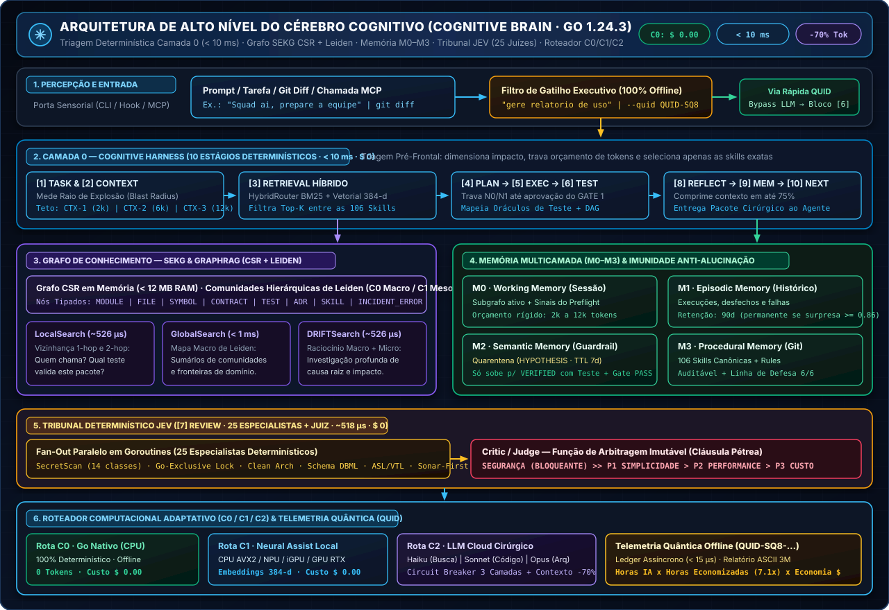
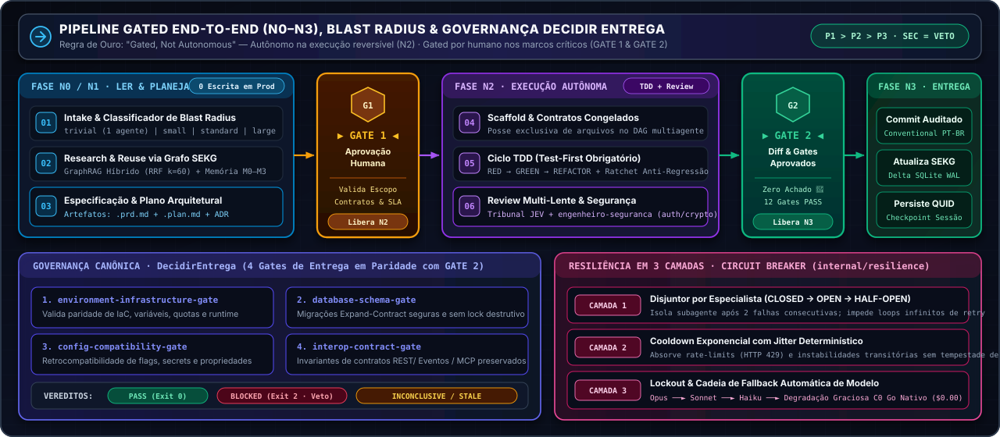

<div align="center">
  

  # SquadAI Harness (`squad-ai-harness`) · v0.8.1

  **Gated Autonomous Software Engineering · Runtime Nativo em Go 1.24.3 (`CGO_ENABLED=0`)**

  [](pkg/contracts/contracts.go)
  [](go.mod)
  [](go.mod)
  [](governance/registry/registry.json)
  [](internal/jev/)
  [](LICENSE)
</div>

---

## 🎯 Visão Geral

O **SquadAI Harness (`squad-ai-harness`)** é um **orquestrador de engenharia de software autônomo**, regido pela regra **"autônomo na execução, *gated* na decisão"**: investiga, planeja, escreve código, migra legados, roda testes e audita segurança sozinho, exigindo **aprovação humana apenas nos marcos críticos (`GATE 1` e `GATE 2`)**.

Todo o motor cognitivo, grafo de conhecimento, tribunal de revisão, laboratório de Agent Evals, acelerador multi-vendor CPU/GPU, instalador multi-estação, monitor AIOps, servidor MCP e interface web vivem em **um único binário estático em Go 1.24.3 (`CGO_ENABLED=0`)**, com **zero dependências externas** no `go.mod`:

| Pilar | Como Funciona | Ganho Direto |
| :--- | :--- | :--- |
| **108 Skills Auditáveis** | Especialistas em `skills/*/SKILL.md` (Arquitetura, AWS, Go, Java 25, Python, Rust, .NET, Angular, Agent Evals, Bancos, QA e Segurança). | Time virtual sob medida sincronizado em **10 IDEs/CLIs agênticos**. |
| **Cérebro Cognitivo (`< 10 ms`)** | Preflight de 10 estágios + `HybridRouter` (BM25 + Cross-Encoder `128D`) + Grafo `SEKG` (`CSR` + Comunidades de Leiden). | **Reduz 60%–75% dos tokens** enviados ao LLM. |
| **Tribunal JEV (`~518 µs`)** | 25 especialistas determinísticos em paralelo + *Critic/Judge* sob $\text{Segurança} \gg \text{P1 Simplicidade} > \text{P2 Performance} > \text{P3 Custo}$. | Revisão instantânea a **`$ 0.00`** antes do commit. |
| **Agentic Eval Lab (`evallab`)** | Motor `eval-agentic-api` v2.0 (*Demystifying Evals for AI Agents*) com `DecisionTraceAnalyzer`, `PredictiveFailureAnalyzer`, selo `SHA-256` e oráculos diferenciais. | **100% de sucesso autônomo** e paridade funcional em migrações `Python/Java → Go`. |
| **Aceleração Híbrida CPU & GPU** | Roteador `C0` (CPU Go) / `C1` (`NVIDIA CUDA` + `Intel Shared GPU Zero-Copy WDDM AVX2/FMA`) / `C2` (LLM) com guarda anti-overhead PCIe. | Speedup de **4,3× (Intel Shared)** a **10,1× (NVIDIA CUDA)** em lotes densos. |

---

## ✨ Novidades Relevantes da Versão `v0.8.1`

1. **`eval-agentic-api` v2.0 & Agentic Software Engineering Evaluation Lab ([`internal/evallab/`](internal/evallab/))**:
   - Engenharia e migração autônoma de APIs (`Go`, `Java 25`, `Rust`, `Python` na AWS `Step Functions`, `Lambda`, `ECS` ou modo `"Decida por mim"`) guiada por *Agent Evals* (`Tasks`, `Trials`, `Transcripts`, `Outcomes`, Graders em 3 camadas e consistência estrita $\text{pass}\text{\textasciicircum}k = p^k$).
   - **Rastreabilidade Cognitiva (`DecisionTraceAnalyzer`) e Predição (`PredictiveFailureAnalyzer`)**: avalia 10 dimensões cognitivas e 12 métricas formais, sela critérios com `SHA-256` contra *reward hacking*, preserva contratos legados via *Dual-Contract Adapter* (`v1` imutável + `v2`/`v3` evoluídos) e retoma falhas por checkpoints idempotentes (`0` efeitos colaterais duplicados).
2. **Aceleração Multi-Vendor GPU/CPU (`NVIDIA CUDA` + `Intel Shared GPU Zero-Copy WDDM`)**:
   - Integração dos módulos de alto desempenho (`POC-001/002/003/004/006/007/008/010` com scores `88,5–91,4/100` em [`templates/squad-ai-gpu-lab/`](templates/squad-ai-gpu-lab/)).
   - Estações **sem GPU dedicada** operam automaticamente em **Memória Unificada (`htod = 0 µs`, `dtoh = 0 µs`)** com kernels `AVX2 + FMA` (`4,31×` mais rápido que CPU escalar), enquanto GPUs NVIDIA dedicadas atingem `10,06×` em lotes $M,N,K \ge 128$. Workloads pequenos ($N < 128$) permanecem na CPU Go nativa (`0,45 µs`), evitando o custo do barramento PCIe.
3. **Monitor AIOps Lite v2.0 + LocalStack (`$0.00 AWS`) & 10 Estações Agênticas**:
   - Descoberta local de Terraform/OpenAPI, grafo AIOps e detecção de *Silent Drift* (`F1 = 1.0000`) via `.\squad-harness.exe monitor`.
   - Sincronização concorrente (`.\squad-harness.exe install`) validada por manifesto `SHA-256` em **10 ambientes**: Claude Code, Google Antigravity, Cursor, GitHub Copilot, OpenAI Codex, Windsurf, Gemini CLI, Cline, Qwen e DeepSeek Harness.

---

## 📊 Performance Medida (Legado Python vs. Runtime Go `v0.8.1`)

Medições auditáveis ([`docs/BENCHMARKS-V080.md`](docs/BENCHMARKS-V080.md) · [`docs/auditoria-eval-agentic-api-2026-10-31/RELATORIO_EXECUTIVO_E_TECNICO.md`](docs/auditoria-eval-agentic-api-2026-10-31/RELATORIO_EXECUTIVO_E_TECNICO.md)):

| Operação | Legado (Python 3.13) | Go Nativo (`v0.8.1`) | Ganho Medido |
| :--- | :---: | :---: | :---: |
| **Unified Quality Gate (`gate` — 6 estágios DAG)** | `21.960,00 ms` | **`288,12 ms`** | **76,2× mais rápido** (`-98,7%`) |
| **Preflight Cognitivo Camada 0 (10 estágios)** | `1.391,00 ms` | **`8,42 ms`** | **165,2× mais rápido** (`-99,4%`) |
| **Tribunal JEV (25 Especialistas + Juiz)** | `485,00 ms` | **`0,518 ms` (`518 µs`)** | **936,3× mais rápido** |
| **Hot-Path Hook (`PreToolUse` Security Guard)** | `185,00 ms` | **`0,524 ms` (`524 µs`)** | **353,1× mais rápido** |
| **GraphRAG (`Local` / `Global` / `DRIFT`)** | `312,00 ms` | **`526 µs`** | **> 590× mais rápido** |
| **Sucesso Autônomo Held-Out (`evallab` Grupo D)** | `72,0%` (`14.850 tok`) | **`100,0%` (`4.120 tok`)** | **+28,0 p.p.** (`-72,3% tokens`) |
| **Consumo de Memória RAM (Heap Ativo)** | `~421,80 MiB` | **`3,20 MiB`** | **131,8× menos RAM** (`-99,2%`) |

---

## 🧠 Arquitetura do Cérebro Cognitivo & Pipeline Gated

<div align="center">
  
</div>

<div align="center">
  
</div>

| Bloco / Camada | Como Opera (`Go 1.24.3`) | Benefício |
| :--- | :--- | :--- |
| **Camada 0 + `HybridRouter`** | Mede o *blast radius* (`trivial` a `large`), trava o orçamento (`CTX-1..3`) e ranqueia as 108 skills via BM25 + Cross-Encoder `128D`. | **Economiza 60%–75% dos tokens** de contexto. |
| **Grafo `SEKG` (`CSR` + Leiden)** | Mapeia em RAM *quem chama quem*, impacto em 4 saltos e cobertura de testes (`Local`, `Global`, `DRIFT`). | Zero alucinação estrutural em **`~526 µs`** (`$ 0`). |
| **Memória `M0–M3` + `Cultivator`** | Separa hipóteses em quarentena (`HYPOTHESIS`) de episódios verificados (`VERIFIED`) e antecipa bloqueios via PQL/RelGT (`POC-001`). | Evolução contínua sem contaminar a memória. |
| **Pipeline `GATE 1` / `GATE 2`** | Permanece em `N0/N1` até aprovação humana do plano (`GATE 1`) e exige veredito `PASS` nos 4 gates de entrega antes do commit (`GATE 2`). | Autonomia com governança proporcional ao risco. |

---

## 🗺️ Mapa das 108 Skills por Domínio ([`governance/registry/registry.json`](governance/registry/registry.json))

| Domínio | Skills de Destaque (`skills/*/SKILL.md`) | Modelo (`P3`) | Escopo Principal |
| :--- | :--- | :---: | :--- |
| **1. Orquestração & Evals** | `squad-ai`, `squad-pipeline`, `eval-agentic-api`, `comissao-arquitetos`, `batman` | `opus` | Sistemas E2E, criação/migração de APIs orientada a Agent Evals e modo noturno. |
| **2. Especificação & DDD** | `engenheiro-especificacao`, `diagramador`, `sandeco-loop`, `spec-code-drift-detector` | `sonnet` | Requisitos BDD/Gherkin, EventStorming, diagramas C4/Mermaid e detecção de drift. |
| **3. Arquitetura & SLA** | `arquiteto-minimalista`, `engenheiro-clean-architect`, `arquiteto-performance`, `sonar-first-engineering` | `opus` | Combate a overengineering, Clean Architecture, SLA p95/p99 e qualidade Sonar. |
| **4. Cloud AWS** | `arquiteto-cloud-aws`, `aws-serverless-eda`, `orquestracao-step-functions`, `api-gateway-integracoes`, `analise-producao-aws` | `opus` | AWS Serverless/Enterprise, FinOps, ASL Step Functions e integrações API Gateway. |
| **5. Backend & Runtimes** | `golang-pro`, `aws-lambda-go`, `java25-spring-boot`, `quarkus-java-aot`, `python-pro`, `rust-pro`, `dotnet-csharp-pro`, `nodejs-pro` | `sonnet` | Código idiomático, concorrência, GraalVM/AOT e eficiência de memória RAM. |
| **6. Frontend & UI/UX** | `especialista-frontend`, `typescript-pro`, `angular-error-investigator`, `ui-ux-pro-max`, `validador-navegador` | `sonnet` | Angular 22 Signals, TypeScript 7, ergonomia (ISO 9241-110, KLM-GOMS, APCA) e E2E. |
| **7. Bancos & Streaming** | `especialista-banco`, `arquiteto-dados-streaming`, `localstack-dev` | `sonnet` | Modelagem DBML-first, SQL/NoSQL, migrações *Expand-Contract* e Kafka/Kinesis. |
| **8. IA, GPU & MCP** | `arquiteto-ia`, `ai-evaluation`, `inferencia-gpu-local`, `mcp-builder`, `graphify`, `roteamento-modelo-adaptativo`, `resiliencia-agente` | `opus` | Agentes LLM, RAG, inferência GPU local, servidores MCP e Circuit Breaker 3 camadas. |
| **9. Qualidade & Caos** | `especialista-qualidade`, `estrategia-testes-aws`, `contrato-reverso`, `testes-carga-desempenho-aws`, `testes-resiliencia-caos-aws` | `sonnet` | TDD/BDD, Testcontainers, contrato reverso (CDC `v1`/`v2`), k6 e caos (AWS FIS). |
| **10. Segurança & AIOps** | `engenheiro-seguranca`, `auditoria-skill-externa`, `engenheiro-iac`, `logs-observabilidade`, `monitor-aiops`, `trace2local` | `opus` | **Automático** em diffs de auth/input/queries/secrets; Terraform, APM e AIOps local. |

---

## 🚀 Guia Rápido de Instalação e Uso

### 1. Compilar e Sincronizar as 108 Skills nas Estações Agênticas

```powershell
# Compilar o binário estático (Windows PowerShell)
$env:CGO_ENABLED="0"; go build -trimpath -ldflags="-s -w" -o squad-harness.exe ./cmd/squad-harness

# Detectar agentes locais (~/.claude, ~/.gemini/config, ~/.cursor, ~/.copilot, ~/.codex...), instalar e verificar SHA-256
.\squad-harness.exe install detect
.\squad-harness.exe install
.\squad-harness.exe install verify
```

### 2. Comandos Principais

```powershell
.\squad-harness.exe version                                                        # Identidade v0.8.1, Go 1.24.3 e RAM livre
.\squad-harness.exe gate                                                           # Quality Gate completo em DAG concorrente (6 estágios)
.\squad-harness.exe evallab --export                                               # Roda o Agentic Evaluation Lab (Experimentos A-E)
.\squad-harness.exe preflight "Squad ai, prepare a equipe. Quero migrar uma api usando o eval."
.\squad-harness.exe compute                                                        # Diagnóstico CPU / Intel Shared GPU / NVIDIA CUDA
.\squad-harness.exe sekg query "eval-agentic-api" local                            # Busca no grafo SEKG (local | global | drift)
.\squad-harness.exe jev "func Handler() error { return nil }"                      # Avalia código no Tribunal JEV (25 especialistas)
.\squad-harness.exe monitor up --smoke                                             # Inicia o Monitor AIOps Lite + LocalStack ($0.00 AWS)
.\squad-harness.exe ui                                                             # Control Center Web (http://127.0.0.1:9090)
.\squad-harness.exe report                                                         # Relatório Executivo ASCII (Horas e Economia em $)
```

---

## 📂 Estrutura do Repositório & Segurança (`Go-Exclusive Lock`)

```text
squad-ai-harness/
├── assets/             # Identidade visual oficial e diagramas arquiteturais (JPG + SVG)
├── cmd/squad-harness/  # CLI unificado (gate, preflight, evallab, sekg, jev, compute, install, report, ui, monitor, mcp, sync)
├── internal/           # Core Go: cognitive, evallab, aiops, jev, gates, compute, scheduler, dag, installer, telemetry, ui
├── pkg/contracts/      # Contratos imutáveis (GateState, ProvenanceKind, ContextTier, Identidade v0.8.1)
├── skills/             # Catálogo canônico das 108 skills especializadas (SKILL.md + references + evals)
├── templates/          # Catálogos de referência multi-stack e laboratório GPU/Rust/CUDA (squad-ai-gpu-lab)
├── governance/         # Políticas de autonomia (N0-N3), gates de entrega e registry gerado
└── security/           # Política de segurança, Linha de Defesa de Prompt e checklist pré-commit
```

- **Trava Exclusiva Go (`stage1.go_exclusive_lock`)**: bloqueia automaticamente (`Exit Code 2`) qualquer código ou manifesto de outra linguagem no fonte do harness ([`internal/gates/gopurity.go`](internal/gates/gopurity.go)).
- **Defesa em Profundidade**: zero dependências externas no `go.mod`, Linha de Defesa de Prompt validada nas 108 skills, selo `SHA-256` em critérios de avaliação e `secretscan` nativo (14 classes de segredos). Consulte [`SECURITY.md`](SECURITY.md) e [`CONTRIBUTING.md`](CONTRIBUTING.md).

---

## 📄 Licença e Histórico de Criação

Distribuído sob a licença **Apache 2.0** ([`LICENSE`](LICENSE)) · **Criação (Repositório Legado Python):** `02/06/2026` · **Migração para Go:** `30/10/2026` · **Versão `v0.8.1`:** `31/10/2026` · **Autor:** [Thiago Gonçalo](https://www.linkedin.com/in/thiago-gon%C3%A7alo)
