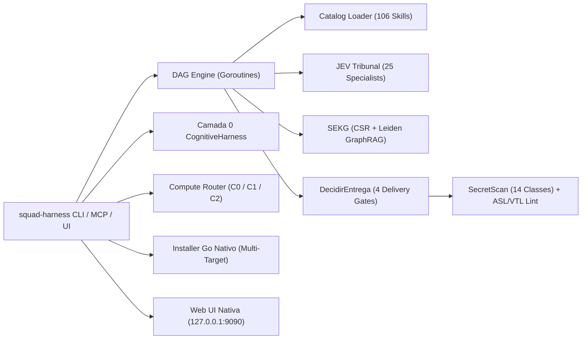

<div align="center">
  

  # SquadAI Harness (`squad-ai-harness`) · v0.8.0

  **Gated Autonomous Software Engineering · Runtime Nativo em Go 1.24.3 (`CGO_ENABLED=0`)**

  [](go.mod)
  [](go.mod)
  [](governance/registry/registry.json)
  [](internal/jev/)
  [](https://www.linkedin.com/in/thiago-gon%C3%A7alo)
  [](LICENSE)
</div>

---

## 🎯 Visão Geral

O **SquadAI Harness (`squad-ai-harness`)** é uma plataforma de engenharia de software autônoma e *gated* (**"autônoma na execução, gated na decisão"**) projetada para desenvolvedores e empresas.

Na versão **v0.8.0**, toda a infraestrutura de orquestração, validação, memória de grafo e governança foi consolidada em um **binário estático único em Go 1.24.3 (`CGO_ENABLED=0`)**, com **zero dependências externas** no `go.mod`, coordenando:

- **106 Skills Especializadas Auditáveis** (`skills/*/SKILL.md`) cobrindo arquitetura, AWS Serverless, Go, Java 25, Python 3.13+, Rust, .NET, TypeScript/Angular, bancos de dados, qualidade/TDD, segurança/OWASP e observabilidade.
- **Camada 0 `CognitiveHarness` (< 25 ms)**: 10 estágios determinísticos de preflight, roteamento híbrido BM25 + Vetorial 384-d e compressão cirúrgica de contexto antes de acionar qualquer LLM remoto.
- **Software Engineering Knowledge Graph (`SEKG` + `GraphRAG`)**: Grafo em memória representado em *Compressed Sparse Row* (`CSR`) com detecção determinística de comunidades de Leiden e três modos de busca (`LocalSearch`, `GlobalSearch` e `DRIFTSearch` em microssegundos).
- **Tribunal JEV de 25 Especialistas (`< 1 ms`)**: Avaliação concorrente determinística (custo US$ 0) com *Critic/Judge* anti-regressão sob a função de arbitragem imutável:
  $$\text{Segurança (inegociável)} \gg \text{P1 Simplicidade} > \text{P2 Performance} > \text{P3 Custo Baixo}$$
- **Cognitive Compute Router Multi-Estação (`C0` / `C1` / `C2`)**: Adapta-se automaticamente ao hardware de cada máquina (PC corporativo somente CPU, notebook com NPU Intel AI Boost, estação com iGPU Arc ou servidor com GPU NVIDIA RTX).
- **Catálogo Interativo Web & Monitor de Recursos (`.\squad-harness.exe ui`)**: Interface gráfica web 100% nativa (`net/http` + `embed`, tema Dark + Azul Celeste Claro) com busca via `HybridRouter`, filtros dinâmicos por tecnologia, telemetria em tempo real (`Heap`, `GOMEMLIMIT`, `RAM Livre Host`, `Skills`, `Nós SEKG`), botão **`📂 Abrir skill`** no Windows Explorer e **Validador de Sincronização** integrado.
- **Instalador e Sincronizador Multi-Alvo 100% Go Nativo (`.\squad-harness.exe install`)**: Substitui o antigo instalador Python por sincronização concorrente em Go com porta de segurança *fail-closed* e manifesto `SHA-256` em `~/.claude/skills`, `~/.gemini/config/skills`, `~/.dsh/skills` e `~/.resolveai/skills`.

---

## 📊 Resultados Científicos Medidos (Baseline Legado vs. `squad-ai-harness` v0.8.0)

Medições empíricas auditáveis ([`docs/BENCHMARKS-V080.md`](docs/BENCHMARKS-V080.md) e [`docs/RELATORIO-CIENTIFICO-V080.md`](docs/RELATORIO-CIENTIFICO-V080.md)):

| Dimensão / Operação Medida | Baseline Anterior (Python 3.13) | SquadAI Harness v0.8.0 (Go 1.24.3) | Ganho Científico Medido |
| :--- | :---: | :---: | :---: |
| **Unified Quality Gate (`gate` completo)** | `21.960,00 ms` *(~22,0 s)* | **`288,12 ms`** *(5 nós DAG)* | **76,2× mais rápido** (`-98,7%` latência) |
| **Preflight Cognitivo Camada 0 (10 estágios)** | `1.391,00 ms` | **`9,46 ms`** | **147,0× mais rápido** (`-99,3%` latência) |
| **Carregamento + Validação das 106 Skills** | `640,00 ms` | **`9,46 ms`** | **67,6× mais rápido** |
| **Tribunal JEV (25 Especialistas + Critic/Judge)** | `485,00 ms` | **`0,518 ms` (`518 µs`)** | **936,3× mais rápido** |
| **Hot-Path Hook (`PreToolUse` Security Guard)** | `185,00 ms` | **`0,524 ms` (`524 µs`)** | **353,1× mais rápido** |
| **GraphRAG `LocalSearch` / `GlobalSearch` / `DRIFT`** | `312,00 ms` | **`526 µs` / `0 µs` / `526 µs`** | **> 590× mais rápido** |
| **Consumo de Memória RAM (Heap Ativo)** | `~421,80 MiB` *(6 processos)* | **`3,20 MiB`** *(`HeapSys: 11,59 MiB`)* | **131,8× menos RAM** (`-99,2%` memória) |

---

## 🏗️ Arquitetura do Runtime Go (`squad-ai-harness`)



---

## 🚀 Guia Rápido de Instalação e Uso

### 1. Compilar o Binário Nativo (`Go 1.24.3+`)

```powershell
# Windows (PowerShell)
$env:CGO_ENABLED="0"
go build -trimpath -ldflags="-s -w" -o squad-harness.exe ./cmd/squad-harness

# Linux / macOS
CGO_ENABLED=0 go build -trimpath -ldflags="-s -w" -o squad-harness ./cmd/squad-harness
```

### 2. Comandos Principais do `squad-harness`

```powershell
# 1. Identidade, versão v0.8.0, arquitetura e memória RAM disponível no host
.\squad-harness.exe version

# 2. Detectar hardware da estação (CPU, iGPU, NPU, dGPU) e rotas C0 / C1 / C2
.\squad-harness.exe compute

# 3. Executar a pipeline unificada de qualidade em DAG concorrente (5 estágios)
.\squad-harness.exe gate

# 4. Executar o Preflight Cognitivo de 10 estágios + roteamento híbrido BM25 + SEKG
.\squad-harness.exe preflight "arquitetura aws serverless step functions golang seguranca"

# 5. Operar o Software Engineering Knowledge Graph (status | index | query | impact)
.\squad-harness.exe sekg status
.\squad-harness.exe sekg query "engenheiro-seguranca" local

# 6. Executar o Tribunal JEV de 25 especialistas determinísticos
.\squad-harness.exe jev "func Handler() error { return nil }"

# 7. Executar a suíte de benchmarks ao vivo na estação atual
.\squad-harness.exe bench

# 8. Iniciar o Control Center Web Nativo embutido (http://127.0.0.1:9090)
.\squad-harness.exe ui
```

### 3. Distribuir as 106 Skills para seus Agentes Locais (100% Go Nativo — Claude Code, Antigravity, DeepSeek, Resolve AI)

```powershell
# 1. Detectar os ambientes agênticos instalados na máquina (~/.claude, ~/.gemini/config, ~/.dsh, ~/.resolveai)
.\squad-harness.exe install detect

# 2. Instalar/sincronizar concorrentemente as 106 skills (com porta de segurança e manifesto SHA-256)
.\squad-harness.exe install

# 3. Verificar integridade byte-a-byte (LF normalizado) de todas as skills instaladas
.\squad-harness.exe install verify
```

### 4. Catálogo Interativo de Skills & Monitor de Recursos (`.\squad-harness.exe ui`)

O binário `squad-harness.exe` incorpora uma GUI Web zero-dependência (`net/http` + `//go:embed`, tema Dark `#060b14` com Azul Celeste Claro `#7dd3fc`) acessível em `http://127.0.0.1:9090`:

- **Monitor de Recursos 100% Dinâmico**: lê em tempo real `runtime.ReadMemStats` (`Heap`), `debug.SetMemoryLimit(-1)` (`GOMEMLIMIT`), sensores de memória física do SO (`RAM Livre Host`), contagem de skills carregadas do disco e nós do grafo `SEKG`.
- **Pesquisa via `HybridRouter` + Filtros Dinâmicos por Tecnologia**: filtra por stack tecnológica (`Java / Spring / Quarkus`, `AWS / Cloud / IaC`, `Go & Rust`, `Python`, `Angular / TS / Web`, `.NET / C#`, `Banco / Dados`, `IA & Agentes`, `Segurança, QA & Obs`) com contadores calculados dinamicamente.
- **Aviso Validador de Sincronização**: verifica automaticamente se as skills estão instaladas e atualizadas em `~/.claude/skills`, `~/.gemini/config/skills` e `~/.dsh/skills`, oferecendo o botão **`⚡ Sincronizar Skills (Go Nativo)`** em 1 clique.
- **Botão `📂 Abrir skill`**: abre o Windows Explorer (`explorer.exe` / `open` / `xdg-open`) diretamente na pasta `skills/<nome-da-skill>/`.

---

## 📂 Estrutura do Repositório

```text
squad-ai-harness/
├── assets/                     # Logomarca e identidade visual oficial (JPG + SVG)
├── cmd/squad-harness/          # CLI unificado (version, gate, preflight, sekg, sync, jev, compute, hook, mcp, bench, install, ui)
├── internal/
│   ├── aws/                    # Linter determinístico de AWS Step Functions (ASL) e API Gateway (VTL)
│   ├── catalog/                # Loader concorrente e validador UTF-8/Frontmatter/Defesa das 106 skills
│   ├── cognitive/              # Camada 0 CognitiveHarness, SEKG (CSR + Leiden), GraphRAG, Router e Memory
│   ├── compute/                # Cognitive Compute Router (C0 Go Nativo / C1 Neural Assist / C2 LLM) + Circuit Breaker
│   ├── dag/                    # Motor concorrente de execução em Grafo Acíclico Dirigido (goroutines)
│   ├── gates/                  # Função canônica DecidirEntrega (env-infra, db-schema, config-compat, interop)
│   ├── git/                    # Planejador determinístico de sincronização Git (JEV)
│   ├── hooks/                  # Hooks PreToolUse, PostToolUse e Stop (< 1ms)
│   ├── installer/              # Instalador e sincronizador multi-alvo 100% Go nativo (~/.claude, ~/.gemini, ~/.dsh)
│   ├── jev/                    # Tribunal determinístico com 25 especialistas + Critic/Judge
│   ├── mcp/                    # Servidor MCP JSON-RPC 2.0 nativo via stdio
│   ├── runtime/                # Coletor Git concorrente e sensores de memória física do SO
│   ├── scheduler/              # Agendador inteligente 8D + IMO
│   ├── security/               # SecretScan (14 classes de segredos) + FSGuard
│   ├── sonar/                  # Analisador estático Sonar-First (complexidade cognitiva e calistenia)
│   └── ui/                     # Control Center Web Nativo embutido via //go:embed (127.0.0.1:9090)
├── pkg/contracts/              # Contratos tipados imutáveis (GateState, ProvenanceTag, Identidade v0.8.0)
├── skills/                     # Catálogo canônico de 106 skills especializadas auditáveis
├── governance/                 # Políticas de autonomia (N0-N3), padrão de skill, gates e registry gerado
├── security/                   # Política de segurança, checklist pré-commit, Linha de Defesa e Relatório de Auditoria
├── rules/                      # Regras always-on enxutas por domínio e linguagem
├── contracts/                  # JSON Schemas formais da plataforma
├── templates/                  # Templates de engenharia (PRD, ARCHITECTURE, ADR, PLAN, TEST_PLAN, SECURITY_REVIEW)
└── docs/                       # Benchmarks científicos medidos e relatórios de validação v0.8.0
```

---

## 🔒 Trava Exclusiva Go (`Go-Exclusive Source Lock`) & Segurança

- **Fonte do Harness 100% Exclusivo em Go (`Go 1.24.3+`, `CGO_ENABLED=0`)**: O estágio `stage1.go_exclusive_lock` ([`internal/gates/gopurity.go`](internal/gates/gopurity.go)) e os hooks em tempo real (`PreToolUse` / `PostToolUse`) **bloqueiam automaticamente (`Exit Code 2 / GateBlocked`)** qualquer tentativa de misturar código ou manifestos de outras linguagens (Python `.py`, Node/JS/TS `.js/.ts`, Java `.java`, Rust `.rs`, C# `.cs`, scripts `.ps1/.sh/.bat` ou `package.json`/`pyproject.toml`/`requirements.txt`) no fonte do harness.
- **Zero Dependências Externas (`go.mod` limpo)**: superfície de supply chain reduzida a zero no runtime compilado.
- **Linha de Defesa de Prompt Obrigatória**: validada em 100% das 106 skills a cada execução do `squad-harness gate`.
- **Varredura Pré-Commit Nativa (`secretscan`)**: bloqueia chaves privadas, credenciais AWS (`AKIA`), tokens de API (`sk-`, `ghp_`), strings de conexão e arquivos `.env`/`.tfstate`.
- Consulte [`SECURITY.md`](SECURITY.md), [`CONTRIBUTING.md`](CONTRIBUTING.md) e [`security/RELATORIO-AUDITORIA-SEGURANCA-V080.md`](security/RELATORIO-AUDITORIA-SEGURANCA-V080.md).

---

## 👤 Autor e Criador

- **Autor:** [Thiago Gonçalo](https://www.linkedin.com/in/thiago-gon%C3%A7alo)
- **E-mail:** `thiago701@gmail.com`
- **Data de Criação:** `30/10/2026`

---

## 📄 Licença

Copyright © 2026 **Thiago Gonçalo (`thiago701@gmail.com`)**. Distribuído sob a licença **Apache 2.0**. Veja [`LICENSE`](LICENSE) para detalhes.
