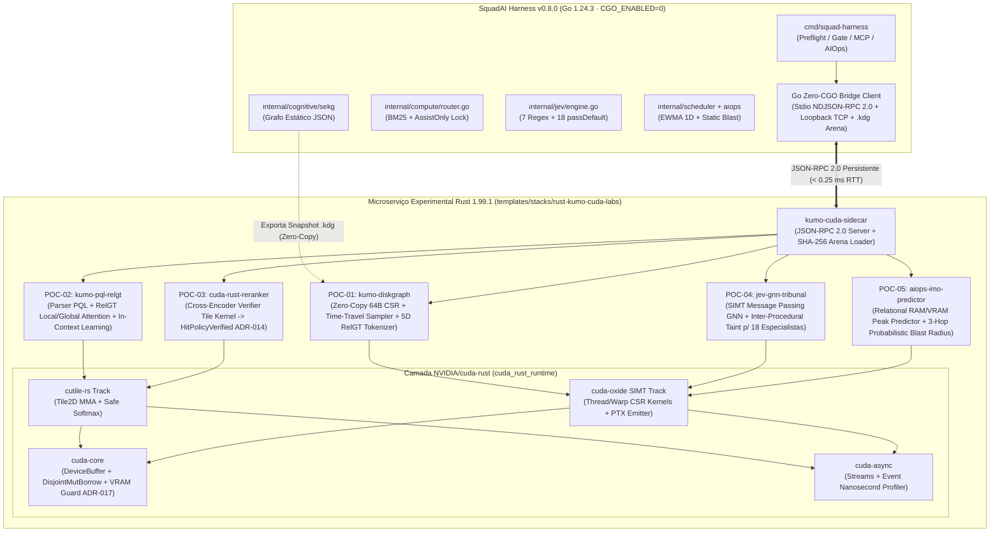

# ESPECIFICAÇÃO EXECUTÁVEL (SPEC) — Microserviço Experimental `squad-kumo-cuda-lab`

> **Versão:** 1.0.0 · **Data:** 2026-10-31 · **Status:** Aprovada pela Comissão de Arquitetos (ADRs 025–028).
> **Invariantes Mensuráveis:**
> - **`0` arquivos não-Go fora de `templates/` e `skills/`** (`VerifyGoExclusiveLock` = `PASS`).
> - **`0` blocos `unsafe` nas 5 POCs de negócio** (`#![forbid(unsafe_code)]`).
> - **`5` POCs em Rust 1.99.1 (Edição 2024) + `1` Ponte IPC Go↔Rust** com testes automatizados e benchmarks reais ($N = 10$).
> - **Paridade de Cosseno $\ge 0.99$** nos kernels `cutile-rs` e **`Recall = 1.00`** nas guardas de segurança.

---

## 1. Visão Geral da Arquitetura Híbrida Go (Squad AI) ↔ Rust (Kumo + CUDA-Rust)



---

## 2. Catálogo Detalhado das 5 POCs e Mapeamento de Gaps

| POC | Nome do Módulo Rust | Gap da Squad AI Resolvido | Tecnologia Kumo Aplicada | Tecnologia `NVIDIA/cuda-rust` Aplicada | Métrica Científica Principal |
|---|---|---|---|---|---|
| **POC-01** | `poc01_kumo_diskgraph` | **GAP-01:** `sekg.go` em JSON s/ filtro temporal e limitado por RAM | **Kumo `DiskGraph`** (CSR binário 64B-aligned) + **Time-Travel Sampler** (`t <= anchor`) + **5D Multi-Element Tokenizer** | **`cuda-oxide` SIMT** (expansão paralela de fronteira CSR por warp) + **`cuda-core`** (`DeviceSlice`) | Throughput de amostragem (subgrafos/s), Zero *Temporal Leakage* (`100%`) e Redução de Pegada de Heap (`> 85%`) |
| **POC-02** | `poc02_kumo_pql_relgt` | **GAP-02:** `memory.go` e `cultivator.go` sem predição relacional nem query declarativa | **Kumo `PQL`** (`PREDICT ... FOR EACH ... ASSUMING ...`) + **`RelGT`** (Local Subgraph + Global Centroid Attention) + **In-Context Learning (ICL)** | **`cutile-rs` Tile Track** (`Tile2D<f32, 16, 16>` Tiled MatMul + Online Softmax) | $F_1$-Score e Brier Score na predição de falha de Gate / regressão vs. heurística Go AS-IS |
| **POC-03** | `poc03_cuda_reranker` | **GAP-03:** `compute/router.go` preso em `HitPolicyAssistOnly` (ADR-014) e `router.go` léxico (BM25) | Embeddings multi-elemento de consulta e catálogo de skills | **`cutile-rs` Cross-Encoder Kernel** + **`cuda-core` Disjoint Borrow** + Quantização Calibrada (`INT8_STATIC` vs `FP32`) | **NDCG@3 / Recall@1** em queries semânticas difíceis + **Paridade de Cosseno $\ge 0.998$** destravando `HitPolicyVerified` |
| **POC-04** | `poc04_jev_gnn_tribunal` | **GAP-04:** `jev/engine.go` com **18/25 especialistas em `passDefault`** (`APPROVE` fixo) | Grafo Relacional Heterogêneo de Código (AST/CallGraph/Dataflow/Camadas) | **`cuda-oxide` SIMT** (Message Passing GNN + Propagação de Taint por Thread/Warp) | **$F_1$-Score, Precisão e Recall** em mutações arquiteturais, *taint* inter-procedural e concorrência (onde o Go atual faz `FN`) |
| **POC-05** | `poc05_aiops_imo_predictor` | **GAP-05:** `scheduler.go` com chute estático/EWMA 1D e `aiops.go` com `blast_radius` fixo (`42`/`89`) | Regressão Relacional Temporal In-Context sobre o grafo de telemetria e topologia AWS/LocalStack | **`cuda-async` Multi-Stream Pipeline** + **`cuda-oxide` SIMT Cascade Simulation** | **Redução do Erro Médio Absoluto ($\text{MAE}$)** na predição de pico de RAM/VRAM + precisão do *Blast Radius* em 3 saltos |

---

## 3. Contratos de Comunicação Go ↔ Rust (GAP-06)

### 3.1. Envelope JSON-RPC 2.0 (Stdio Pipe & Loopback TCP `127.0.0.1`)
Compatível nativamente com `internal/mcp/server.go`:
```json
{
  "jsonrpc": "2.0",
  "id": 1,
  "method": "kumo.pql.execute",
  "params": {
    "pql": "PREDICT COUNT(gate_episodes.gate_state = 'BLOCKED', 0, 7, days) > 0 FOR EACH modules.module_id ASSUMING touches_auth = true",
    "anchor_time": 1761868800
  }
}
```

### 3.2. Formato Binário Zero-Copy `.kdg` (*Kumo DiskGraph Snapshot*)
| Offset (Bytes) | Campo | Tipo | Descrição |
|---|---|---|---|
| `0..8` | `magic` | `[u8; 8]` | Assinatura `"KUMODG01"` |
| `8..12` | `version` | `u32` (LE) | Versão do layout (`1`) |
| `12..16` | `num_nodes` | `u32` (LE) | Total de nós ($N$) |
| `16..20` | `num_edges` | `u32` (LE) | Total de arestas temporais ($M$) |
| `20..52` | `sha256` | `[u8; 32]` | Digest SHA-256 do payload CSR |
| `52..64` | `reserved` | `[u8; 12]` | Padding para alinhamento exato de cache-line (64 bytes) |
| `64..` | `csr_payload` | `Aligned` | `fwd_offsets [N+1]`, `fwd_targets [M]`, `edge_timestamps [M]`, `node_types [N]`, `node_feats [N*D]` |
