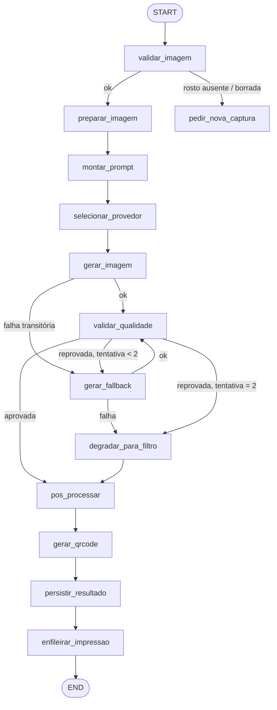

# Grafo stateful na prática — State, checkpoint, resume, interrupt, teste

> Referência da skill `engenheiro-langgraph`.

## 1. Desenhe o grafo antes de codar

Mermaid é barato de mudar; código não é. Valide o desenho com o humano no GATE 1.



Note que **impressão vem depois de persistir**: o resultado do usuário nunca depende da impressora.

## 2. State — armadilhas reais

| Armadilha | Sintoma em evento | Correção |
|---|---|---|
| `bytes` no State | Checkpoint de 8 MB por sessão; SQLite cresce 1 GB numa noite | Guardar `image_ref` (caminho/URI) |
| Handle de câmera no State | `TypeError: cannot pickle` no primeiro checkpoint | Adapter injetado via `config["configurable"]` |
| Dois nós paralelos escrevendo `timings_ms` | Métrica some sem erro | `Annotated[dict, merge_dicts]` |
| `status` como `str` livre | Transição inválida passa despercebida | `Literal[...]` + validação no nó |
| Dado pessoal no State | Rosto persistido no banco de checkpoint | Referência + política de retenção que purga checkpoint junto |

## 3. Injeção de dependência sem import global

```python
cfg = {
    "configurable": {
        "thread_id": session_id,
        "providers": provider_registry,   # objetos vivos: clientes, câmera, impressora
        "settings": settings,
    }
}

async def gerar_imagem(state, config):
    provs = config["configurable"]["providers"]
    ...
```

Isso torna cada nó testável **sem rede e sem hardware**: passe um registry de mocks.

## 4. Retomada após crash

```python
# 1ª execução — morre no meio (kill -9, queda de energia, reboot do totem)
await app.ainvoke(entrada, cfg)

# após reiniciar o processo: retoma do último checkpoint
await app.ainvoke(None, cfg)          # None = "continue de onde parou"

# inspeção
snap = await app.aget_state(cfg)
print(snap.next)      # nós pendentes
print(snap.values)    # State no momento do crash
```

**Teste obrigatório na Fase 0:** matar o worker entre `gerar_imagem` e `gerar_qrcode` e provar
que a sessão conclui sem repetir (nem cobrar de novo) a inferência.

## 5. interrupt() — humano no meio do fluxo

Útil no photobooth para o "aprovar/refazer" do usuário sem manter processo bloqueado:

```python
from langgraph.types import interrupt, Command

async def confirmar_resultado(state):
    escolha = interrupt({"preview_ref": state["processed_image_ref"]})
    return {"aprovado": escolha == "aceitar"}

# retomada quando o usuário toca na tela
await app.ainvoke(Command(resume="aceitar"), cfg)
```

O processo **não fica preso** esperando: o grafo persiste e volta quando o evento chegar. Isso
resolve o requisito "usuário abandonou o fluxo" — a sessão expira por timeout do orquestrador de
sessão, não por thread pendurada.

## 6. Streaming: latência percebida

```python
async for ev in app.astream_events(entrada, cfg, version="v2"):
    if ev["event"] == "on_chain_start":
        await ws.send_json({"etapa": ev["name"]})   # "Preparando sua foto…"
```

Não reduz T7−T0, reduz a **sensação** de espera. Numa fila de evento isso vale tanto quanto
2 s reais. Mostre a etapa por nome humano, nunca o nome técnico do nó.

## 7. Teste do grafo

| Nível | O que testar | Como |
|---|---|---|
| Nó | Contrato de entrada/saída, timeout, taxonomia de erro | `pytest` chamando a função com State sintético |
| Aresta | Cada ramo condicional é alcançável | Tabela de decisão parametrizada |
| Grafo (mock) | Caminho feliz end-to-end sem rede | Registry de mocks via `config` |
| Grafo (fault injection) | Provedor 429/503/timeout, GPU ausente, disco cheio | Mock que levanta erro na n-ésima chamada |
| Durabilidade | `kill -9` entre nós → retomada correta | Subprocesso + checkpointer em arquivo |
| Regressão | Mudança de prompt/modelo × baseline | Skill `ai-evaluation` |

## 8. Erros comuns e o que fazer

| Erro | Causa provável | Correção |
|---|---|---|
| `Checkpointer requires thread_id` | `config` sem `configurable.thread_id` | Sempre passar `cfg` |
| State volta vazio no resume | `thread_id` diferente entre execuções | Derivar de `session_id` |
| Nó roda duas vezes | Efeito colateral fora do State (arquivo, print) sem idempotência | Chave de idempotência por `session_id + nó` |
| Grafo "trava" | Nó sem timeout aguardando socket | `asyncio.timeout` em todo I/O |
| Custo dobrado após crash | Recomeço do zero em vez de resume | Checkpointer ausente ou `thread_id` novo |
