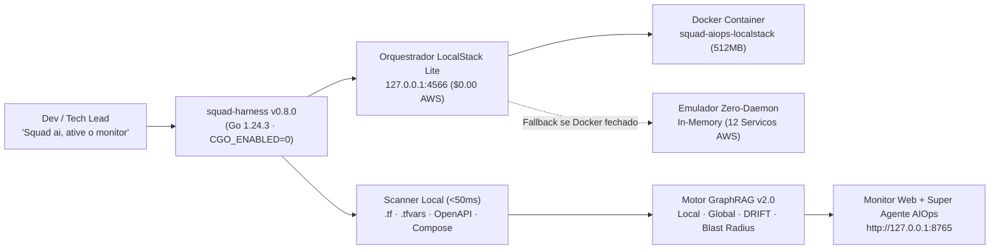

# Arquitetura Lite LocalStack — SquadAI Harness v0.8.0 (`internal/aiops`)

## 1. Visão Geral e Decisões Arquiteturais (ADRs da Comissão de Arquitetos)

A compactação do projeto `agente-ia-devops` (AIOps) para o **SquadAI Harness v0.8.0** foi desenhada pela Comissão de Arquitetos da Squad AI seguindo 5 Decisões Arquiteturais (ADRs):

- **ADR-01 (Binário Único Go 1.24.3, `CGO_ENABLED=0`)**:
  Todo o motor AIOps (`internal/aiops`) reside nativamente no binário `squad-harness` sem dependências externas no `go.mod`, passando no gate `VerifyGoExclusiveLock` e nos 25 especialistas JEV.
- **ADR-02 (Orquestração LocalStack Lite Dual-Mode com Custo US$ 0,00)**:
  - **Modo 1 (`DOCKER_CONTAINER` / `EXTERNAL_LOCALSTACK`)**: Se o Docker estiver ativo, o `squad-harness monitor up` gerencia o container `squad-aiops-localstack` (`localstack/localstack:latest`) em `127.0.0.1:4566`, limitado a `512 MiB` de RAM e com carregamento sob demanda (`EAGER_SERVICE_LOADING=0`).
  - **Modo 2 (`EMULATED_ZERO_DAEMON`)**: Se o Docker Desktop estiver desligado ou a máquina estiver sem RAM livre suficiente, o motor ativa automaticamente o emulador LocalStack Zero-Daemon embutido em Go (respondendo também a `/_localstack/health` na porta do Monitor), garantindo **100% de disponibilidade local**.
- **ADR-03 (Descoberta Determinística de Infraestrutura Local — `DiscoverWorkspace`)**:
  Em vez de depender de APIs pagas da AWS (`AWS Config`, `Resource Explorer`), o scanner local analisa em `< 50 ms`:
  - Recursos Terraform (`resource "<type>" "<name>"` em `*.tf`)
  - Variáveis de ambiente por estágio (`*.tfvars`)
  - Contratos de API (`openapi*.yaml`, `openapi*.json`, `swagger*.yaml`)
  - Topologia de containers locais (`docker-compose*.yml`)
  - Manifestos de linguagens (`go.mod`, `pyproject.toml`, `pom.xml`, `package.json`) e pipelines (`.github/workflows/*.yml`)
- **ADR-04 (Injeção Viva no Monitor GraphRAG v2.0)**:
  O bundle `internal/aiops/static/monitor.html` é servido com `Cache-Control: no-cache, no-store, must-revalidate` e recebe em tempo real os nós, arestas, achados de drift e habilidades customizadas descobertos no workspace da squad.
- **ADR-05 (Super Agente AIOps Híbrido `CAP-01..CAP-32` + Guardrail `CAP-12`)**:
  O Super Agente AIOps combina execução determinística no cliente (para responsividade instantânea) com os endpoints REST locais (`POST /api/chat`, `POST /api/teach`, `POST /api/discover`, `GET /api/graphrag/graph`), respeitando estritamente o bloqueio `CAP-12` (`READ_ONLY_ENFORCED`).

---

## 2. Diagrama da Arquitetura Lite na Estação do Desenvolvedor

---

## 3. Endpoints REST Locais (`http://127.0.0.1:8765`)

| Método e Rota | Finalidade |
| :--- | :--- |
| `GET /` ou `GET /monitor-graphrag` | Interface completa do **Squad-Agentica IAOps · Monitor - GraphRAG v2.0** + Super Agente Flutuante |
| `GET /_localstack/health` | Status de saúde dos 12 serviços AWS emulados no LocalStack Lite (`s3`, `sqs`, `sns`, `lambda`, `dynamodb`, `kms`, etc.) |
| `GET /api/health` | Status consolidado do Monitor Lite (`MonitorStatus`: LocalStack, Descoberta, Guardrail `CAP-12`, FinOps `$0.00`) |
| `GET /api/graphrag/graph` | Payload JSON completo do grafo (`nodes`, `edges`, `communities`, `custom_skills`, `findings`) |
| `POST /api/discover` | Re-executa a descoberta de infraestrutura no workspace local e atualiza o GraphRAG |
| `POST /api/teach` | Cadastra nova habilidade AIOps em 1 prompt e persiste em `.squad-harness/aiops/custom_skills.json` |
| `POST /api/chat` | Envia pergunta/comando ao Super Agente AIOps (`CAP-32`) e retorna resposta estruturada + ações + nós destacados |
