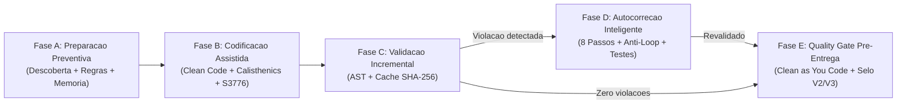

# Pipeline Preventivo Sonar-First (Fases A, B, C, D e E)

> **Implementação canônica:** `scripts/sonar/pipeline.py`, `scripts/sonar/analisador.py`,
> `scripts/sonar/autofix.py` e `scripts/sonar/memoria.py`.

---

## 1. Visão Geral do Fluxo Preventivo

---

## 2. Detalhamento Técnico por Fase

### Fase A — Preparação Preventiva (`executar_fase_ab`)
- **Entrada:** diretório raiz do repositório e lista opcional de arquivos-alvo.
- **Passos:**
  1. `descobrir_projeto(raiz)` identifica linguagens, frameworks, estilo arquitetural e arquivos Sonar (`sonar-project.properties`, `pom.xml`, `.sonarlint/connectedMode.json`, `.vscode/settings.json`).
  2. Verifica presença de `SONAR_HOST_URL` e `SONAR_TOKEN` apenas pelo nome da variável (`os.environ.get`), redigindo qualquer propriedade sensível (`***REDACTED***`).
  3. Consulta `recuperar_diretrizes_recorrentes(raiz, linguagens)` em `memory/sonar-padroes.jsonl` para priorizar regras com histórico de reincidência.
  4. Injeta automaticamente a seção `## Restricoes preventivas Sonar-First (Fase A/B)` no artefato `00-preflight.md` gerado por `scripts/preflight.py`.

### Fase B — Codificação Assistida
- Os especialistas de implementação (`java25-spring-boot`, `java-modernizer`, `python-pro`, `especialista-frontend`, `clean-code-craftsman`) recebem as restrições da Fase A antes de escrever código.
- Regras estruturais aplicadas durante a escrita:
  - Funções com no máximo 30 linhas e classes com no máximo 120 linhas (`calisthenics_check.py`).
  - Nível máximo de indentação/aninhamento `<= 2` e proibição de `else`/`elif` após `return`/`raise`/`continue`/`break` (`python:S1126`).
  - Cognitive Complexity `S3776 <= 15` e Cyclomatic Complexity `S1541 <= 15`.

### Fase C — Validação Incremental (`executar_fase_c_incremental`)
- **Escopo:** analisa apenas os arquivos modificados ou informados na unidade lógica de trabalho.
- **Chave de cache determinística:**
  `sha256(f"{VERSAO_REGRAS}:{linguagem}:{limiar_cognitiva}:{codigo}")`
- **Persistência:** `.cache/sonar-cache.json` (ignorado pelo Git). Se o arquivo não mudou e a versão do catálogo é a mesma, o resultado retorna do cache sem reprocessar AST ou expressões regulares.

### Fase D — Autocorreção Inteligente (`autocorrigir_texto` / `autocorrigir_arquivo`)
Executa rigorosamente os **8 passos** para cada violação:
1. **Encontrar regra:** busca metadados MQR e CWE em `MAPA_REGRAS`.
2. **Determinar causa técnica:** identifica o construto exato na linha apontada.
3. **Selecionar correção de menor impacto:** consulta `classificar_elegibilidade_autofix(violacao)`. Violações complexas (`S3776`, `S6881`, `S3649`, `S2068`) são imediatamente escaladas (`ESCALADA_ESPECIALISTA`).
4. **Preservar contratos:** transformações mecânicas operam apenas sobre o idioma interno da linha sem alterar assinaturas públicas.
5. **Aplicar alteração:** gera candidato em memória e verifica `detectar_supressoes_proibidas` (rejeita se introduzir `NOSONAR`, `@SuppressWarnings` ou `# noqa`).
6. **Executar testes impactados:** invoca o `validador_testes(candidato)`. Se retornar `False`, descarta o candidato com status `ROLLBACK_TESTE_FALHOU`.
7. **Revalidar regra:** reexecuta `analisar_texto_em_memoria` sobre o candidato para confirmar que a violação desapareceu sem introduzir novas violações.
8. **Encerrar ciclo e memorizar:** persiste o padrão em `memory/sonar-padroes.jsonl` somente quando `status_final == "CORRIGIDA"`.

**Guardas anti-loop da Fase D:**
- `max_tentativas = 5` por arquivo.
- `orcamento_ms = 1500.0` ms por arquivo.
- Conjunto `hashes_vistos: set[str]` com o SHA-256 de cada estado do código: se uma transformação produzir estado já visitado, interrompe imediatamente com `loop_detectado = True`.

### Fase E — Quality Gate Pré-Entrega (`auditar_quality_gate_final`)
- Bloqueia (`BLOCKED`) se houver qualquer violação `BLOCKER`, `HIGH`, qualquer achado de `SECURITY`, qualquer tentativa de supressão (`SONAR-NOSONAR`) ou se `testes_verdes == False`.
- Emite explicitamente a modalidade e o nível de validação (`V2` local vs `V3`/`V4` oficial) e lista todos os avisos `[GAP]` aplicáveis.
