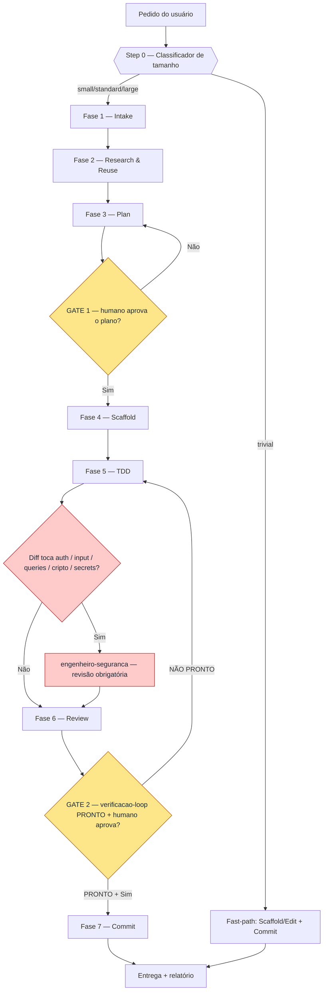

# squad-pipeline · reference — Diagrama do fluxo, wrappers e topologia por tier

> Conteúdo movido VERBATIM do hub `../SKILL.md` (ciclo 4 do Loop V3, 2026-07-09) — progressive
> disclosure. **Nota de resolução de paths:** os caminhos relativos abaixo permanecem como no hub e
> se resolvem a partir de `skills/squad-pipeline/` (raiz da skill), não deste subdiretório.

## Diagrama do fluxo

## Wrappers finos (fachadas)

O motor é compartilhado; os pontos de entrada são wrappers de poucas linhas que invocam esta skill com
um foco:

| Wrapper | Foco | Tier típico |
|---|---|---|
| `squad-nova-feature` | adicionar capacidade nova | standard/large |
| `squad-corrigir-defeito` | corrigir bug com teste de regressão primeiro | small/standard |
| `squad-refatorar` | melhorar estrutura sem mudar comportamento (testes como rede) | small/standard |
| `squad-mvp` | construir produto mínimo do zero | large |

## Topologia de execução por tier (R9)

A cerimônia define *quais fases* rodam; a **topologia** define *como os agentes se distribuem*.
Escolha a mais simples que cabe — paralelismo só quando há frentes genuinamente independentes
(senão é *agent soup*, desperdício de P3).

| Tier | Topologia | Quando |
|---|---|---|
| trivial / small | **sequencial, 1 agente** | escopo claro, 1 frente; o caminho padrão |
| standard | **sequencial com par pontual** | TDD em par (qualidade ↔ clean-architect); ainda 1 frente |
| large | **paralelo controlado (par-de-2 a poucos)** | 2+ bounded contexts/módulos independentes |

> **Paralelismo seguro = worktrees isoladas.** Quando 2+ frentes escrevem ao mesmo tempo, use
> `worktree-lifecycle` (candidata C16 do roadmap) para isolar a árvore de cada agente e prever
> conflitos antes do merge. Sem isso, prefira sequencial — escritas concorrentes na mesma árvore
> são fonte de bug silencioso. Nunca multiplique agentes se uma frente única resolve.
