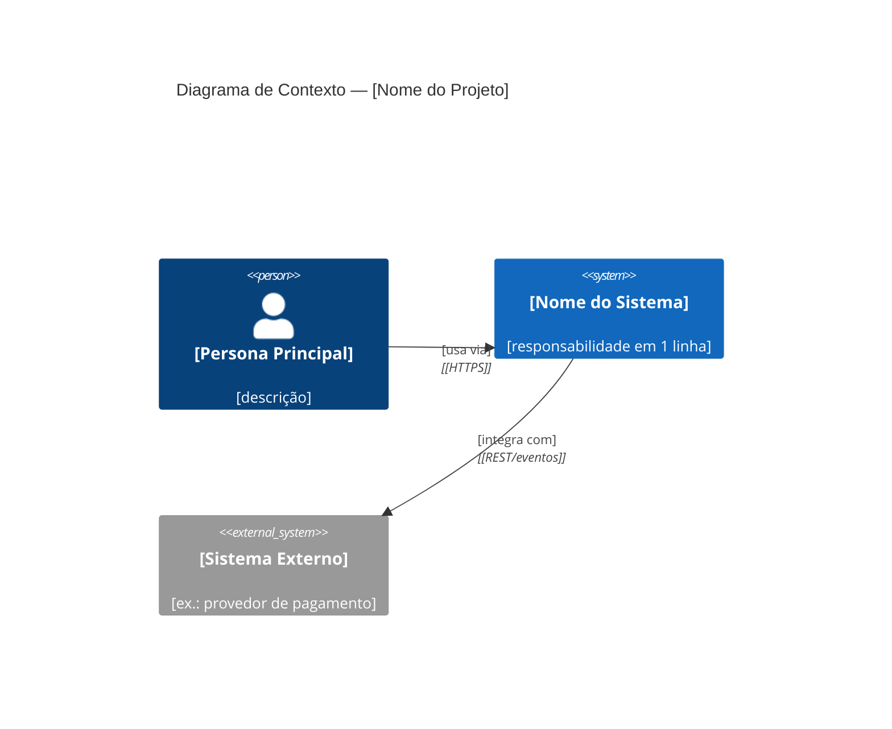
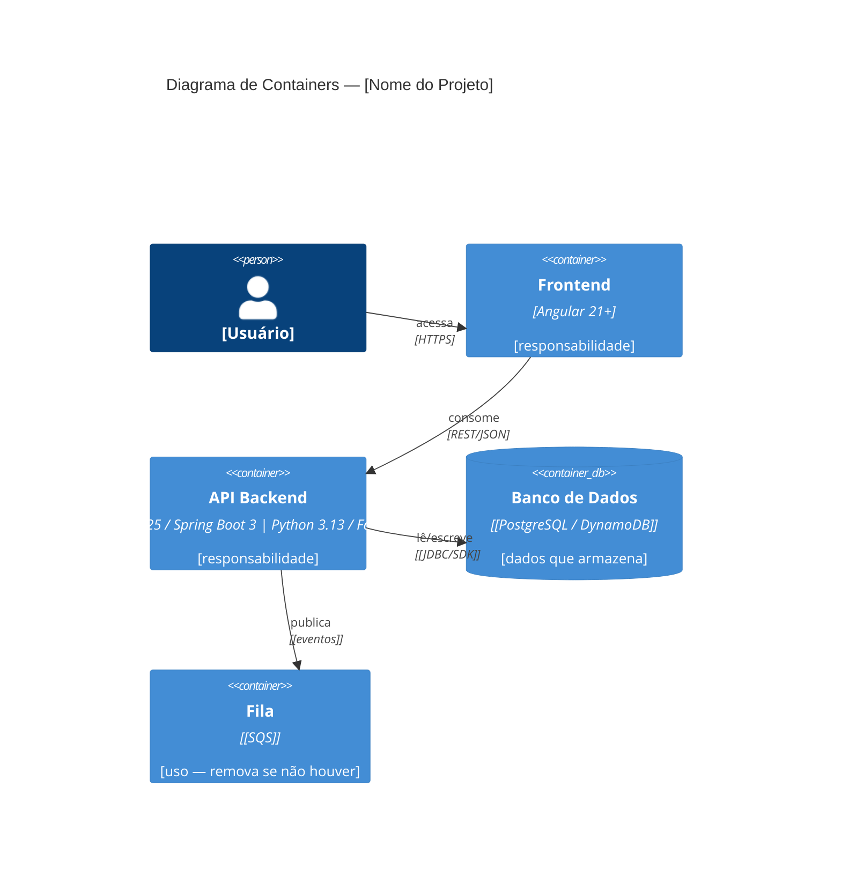
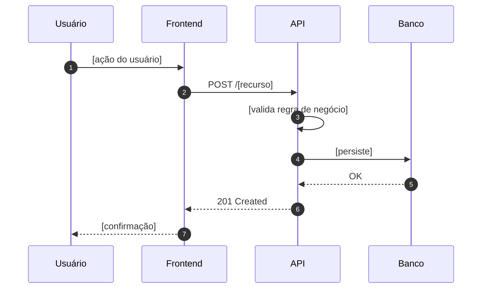

# Arquitetura — [Nome do Projeto]

<!--
  DOCUMENTO DE ARQUITETURA (baseado no modelo C4)
  Quando usar: após o PRD aprovado, antes do plano de implementação.
  Quem preenche: arquiteto-minimalista (lead) + arquiteto-cloud-aws + arquiteto-performance.
  Regra de ouro da Squad: P1-Simplicidade > P2-Performance > P3-CustoBaixo.
  Comece pelo desenho MAIS SIMPLES que atende aos requisitos. Justifique toda complexidade.
-->

| Campo | Valor |
|---|---|
| **Projeto** | [Nome do Projeto] |
| **Versão do documento** | [0.1.0] |
| **Data** | [AAAA-MM-DD] |
| **Autor(es)** | [Nome / Agente] |
| **Status** | [Rascunho \| Em revisão \| Aprovado \| Obsoleto] |
| **PRD relacionado** | [link para PRD.md] |

---

## 1. Contexto (C4 — Nível 1)

<!-- Visão de mais alto nível: o sistema, seus usuários e os sistemas externos.
     Ajuste o diagrama Mermaid abaixo à realidade do projeto. -->

**Resumo em texto:** [1 parágrafo explicando quem usa o sistema, para quê, e com quais sistemas externos ele conversa.]

## 2. Containers (C4 — Nível 2)

<!-- Unidades executáveis/implantáveis: apps, APIs, bancos, filas.
     Prefira o MENOR número de containers possível (P1-Simplicidade). -->

| Container | Tecnologia | Responsabilidade | Hospedagem |
|---|---|---|---|
| [Frontend] | [Angular 21+] | [UI e interação] | [S3 + CloudFront] |
| [API] | [Spring Boot 3 / FastAPI] | [regras de negócio] | [ECS Fargate / Lambda] |
| [Banco] | [PostgreSQL RDS] | [persistência] | [RDS] |

## 3. Componentes (C4 — Nível 3)

<!-- Detalhe APENAS o container mais crítico/complexo. Não documente o óbvio. -->

| Componente | Responsabilidade | Depende de |
|---|---|---|
| [Controller/Router X] | [expõe endpoints de X] | [Service X] |
| [Service X] | [orquestra regra de negócio X] | [Repository X, Cliente Y] |
| [Repository X] | [persistência da entidade X] | [Banco] |

## 4. Decisões-Chave (ADRs)

<!-- Toda decisão estrutural relevante vira um ADR (use templates/ADR.md). Liste e linke aqui. -->

| ADR | Decisão | Status |
|---|---|---|
| [ADR-001](./adr/ADR-001-exemplo.md) | [Escolha do banco de dados] | [Aprovado] |
| [ADR-002](./adr/ADR-002-exemplo.md) | [Estratégia de autenticação] | [Proposto] |

## 5. Stack Escolhida e Justificativa

<!-- Justifique cada escolha contra as prioridades P1 > P2 > P3.
     Desvios da stack de referência da Squad (Java 25/Spring Boot 3, Python 3.13/FastAPI,
     Angular 21+, AWS) exigem ADR próprio. -->

| Camada | Escolha | Justificativa (P1/P2/P3) |
|---|---|---|
| Backend | [Java 25 + Spring Boot 3] | [time domina; ecossistema maduro — P1] |
| Frontend | [Angular 21+] | [padrão da Squad — P1] |
| Banco | [PostgreSQL RDS] | [relacional simples e suficiente — P1, P3] |
| Infra | [AWS — ECS Fargate] | [gerenciado, sem servidores para operar — P1, P3] |
| Observabilidade | [CloudWatch + OpenTelemetry] | [nativo AWS, baixo custo — P3] |

## 6. Fluxos Principais

<!-- Diagrame os 2-3 fluxos mais importantes (felizes e de erro crítico). Sequência Mermaid. -->

### 6.1 [Nome do Fluxo — ex.: Criação de Pedido]

**Pontos de atenção:** [idempotência, timeout, retry — o que merece cuidado neste fluxo.]

## 7. Integrações

<!-- Sistemas externos: protocolo, autenticação, SLA do parceiro e comportamento em falha. -->

| Sistema | Protocolo | Autenticação | SLA do parceiro | Em caso de falha |
|---|---|---|---|---|
| [Sistema X] | [REST/JSON] | [OAuth2 client credentials] | [99,9%] | [retry com backoff + DLQ] |

## 8. Requisitos Transversais

### 8.1 Segurança

<!-- Autenticação, autorização, secrets, criptografia. Detalhe em SECURITY_REVIEW.md. -->

- **Autenticação:** [Cognito / JWT — descreva]
- **Autorização:** [RBAC — papéis e escopos]
- **Secrets:** [AWS Secrets Manager — nunca em código/variáveis commitadas]
- **Dados sensíveis:** [criptografia em trânsito (TLS 1.3) e em repouso (KMS)]

### 8.2 Observabilidade

- **Logs:** [estruturados JSON, correlationId em todas as requisições]
- **Métricas:** [RED: rate, errors, duration — por endpoint]
- **Alertas:** [erro 5xx > X%/5min; p95 > Yms; orçamento mensal excedido]

### 8.3 Performance

| Cenário | SLO | Como garantir |
|---|---|---|
| [Endpoint crítico X] | [p95 < 300ms] | [índice no banco, cache, pool dimensionado] |
| [Throughput] | [X req/s] | [auto-scaling, teste de carga no TEST_PLAN.md] |

## 9. Trade-offs Aceitos

<!-- Toda arquitetura sacrifica algo. Seja explícito sobre o que foi sacrificado e por quê. -->

| Trade-off | Ganho | Custo aceito |
|---|---|---|
| [Monólito modular em vez de microsserviços] | [simplicidade operacional — P1] | [deploy acoplado entre módulos] |
| [...] | [...] | [...] |

## 10. Evolução Prevista

<!-- O que NÃO foi feito agora, mas a arquitetura já comporta. Gatilhos claros para evoluir. -->

| Evolução futura | Gatilho para implementar |
|---|---|
| [Extrair módulo X para serviço próprio] | [módulo X > 50% do tráfego ou time dedicado] |
| [Cache distribuído] | [p95 do endpoint Y > SLO por 2 sprints] |

---

## Histórico de Revisões

| Versão | Data | Autor | Mudança |
|---|---|---|---|
| 0.1.0 | [AAAA-MM-DD] | [autor] | Criação inicial |
