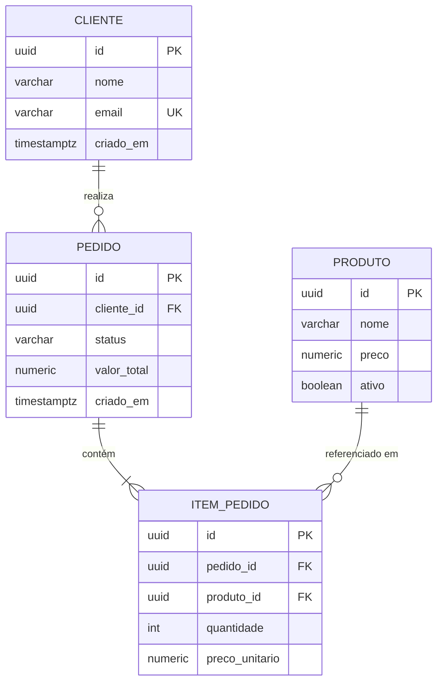

# Modelo de Dados — [Nome do Projeto]

<!--
  MODELO DE DADOS
  Quando usar: ao projetar ou alterar o esquema de dados, junto com ARCHITECTURE.md.
  Quem preenche: engenheiro backend + engenheiro-especificacao; engenheiro-seguranca
  valida a seção de retenção/anonimização (LGPD).
  Regra de ouro: o modelo segue a linguagem ubíqua do domínio. Nomes de tabelas/colunas
  refletem os termos do negócio, sem abreviações obscuras.
-->

| Campo | Valor |
|---|---|
| **Projeto** | [Nome do Projeto] |
| **Versão do documento** | [0.1.0] |
| **Data** | [AAAA-MM-DD] |
| **Autor(es)** | [Nome / Agente] |
| **Status** | [Rascunho \| Em revisão \| Aprovado] |
| **Banco / Versão** | [PostgreSQL 16 \| DynamoDB \| ...] |
| **Ferramenta de migração** | [Flyway \| Liquibase \| Alembic] |

---

## 1. Diagrama Entidade-Relacionamento

<!-- Mantenha o diagrama SINCRONIZADO com as migrações. Ajuste ao domínio real. -->

## 2. Entidades

<!-- Replique o bloco para CADA entidade. Tipos do banco real (não da linguagem).
     Marque dados pessoais/sensíveis na coluna LGPD: (P)essoal, (S)ensível, (-)não. -->

### 2.1 [CLIENTE]

**Descrição:** [o que esta entidade representa no domínio.]

| Coluna | Tipo | Constraints | LGPD | Descrição |
|---|---|---|---|---|
| id | uuid | PK, default gen_random_uuid() | - | Identificador único |
| nome | varchar(150) | NOT NULL | P | Nome completo do cliente |
| email | varchar(255) | NOT NULL, UNIQUE | P | E-mail de contato |
| cpf | varchar(11) | UNIQUE, NULL | S | [criptografado em repouso? mascarado em logs?] |
| criado_em | timestamptz | NOT NULL, default now() | - | Data de criação |
| atualizado_em | timestamptz | NOT NULL, default now() | - | Última atualização |

**Regras de integridade:** [ex.: e-mail validado na aplicação; soft delete via coluna `excluido_em`.]

### 2.2 [PEDIDO]

**Descrição:** [...]

| Coluna | Tipo | Constraints | LGPD | Descrição |
|---|---|---|---|---|
| id | uuid | PK | - | Identificador único |
| cliente_id | uuid | FK → cliente.id, NOT NULL | - | Cliente que realizou o pedido |
| status | varchar(20) | NOT NULL, CHECK (status IN ('CRIADO','PAGO','CANCELADO')) | - | Estado do pedido |
| valor_total | numeric(12,2) | NOT NULL, CHECK (valor_total >= 0) | - | Valor total calculado |

<!-- Repita para as demais entidades... -->

## 3. Relacionamentos

| Relacionamento | Cardinalidade | FK / Mecanismo | Regra de exclusão |
|---|---|---|---|
| CLIENTE → PEDIDO | 1:N | pedido.cliente_id | [RESTRICT — não exclui cliente com pedidos] |
| PEDIDO → ITEM_PEDIDO | 1:N | item_pedido.pedido_id | [CASCADE] |
| PRODUTO → ITEM_PEDIDO | 1:N | item_pedido.produto_id | [RESTRICT] |

## 4. Índices

<!-- Todo índice nasce de uma query real. Documente a query que o justifica.
     Índice sem justificativa = custo de escrita sem retorno. -->

| Índice | Tabela | Colunas | Tipo | Query que justifica |
|---|---|---|---|---|
| idx_pedido_cliente | pedido | (cliente_id, criado_em DESC) | btree | [listagem de pedidos do cliente] |
| idx_pedido_status | pedido | (status) | btree parcial WHERE status = 'CRIADO' | [fila de processamento] |
| uk_cliente_email | cliente | (email) | unique | [login/busca por e-mail] |

## 5. Estratégia de Migração

<!-- Migrações versionadas, imutáveis e aplicadas pelo pipeline — nunca à mão em produção. -->

- **Ferramenta:** [Flyway — `V<versao>__descricao.sql` | Alembic]
- **Regras:**
  - Migração aplicada NUNCA é editada; correção = nova migração
  - Mudanças destrutivas (drop/rename) em duas etapas: expandir → migrar dados → contrair
  - Toda migração testada em CI com Testcontainers antes do merge
  - Rollback: [migração de compensação documentada para mudanças de risco]
- **Migração de dados (backfill):** [como será feito: batch idempotente, janela, volume estimado]

## 6. Retenção e Anonimização de Dados (LGPD)

<!-- Obrigatório para toda entidade com dados pessoais (P/S na seção 2).
     Alinhe com SECURITY_REVIEW.md §7. -->

| Entidade / Dado | Finalidade | Base legal | Retenção | Após o prazo |
|---|---|---|---|---|
| [CLIENTE.cpf] | [emissão fiscal] | [obrigação legal] | [5 anos após último pedido] | [anonimização irreversível] |
| [CLIENTE.email] | [comunicação] | [consentimento] | [enquanto conta ativa] | [exclusão em até 30 dias] |
| [logs com dados pessoais] | [auditoria] | [legítimo interesse] | [12 meses] | [expurgo automático] |

**Processo de exclusão a pedido do titular:** [endpoint/rotina; prazo máximo de atendimento: X dias.]

## 7. Volumetria e Crescimento

<!-- Estimativas guiam decisões de particionamento, arquivamento e custo. -->

| Tabela | Volume inicial | Crescimento/mês | Em 2 anos | Ação se exceder |
|---|---|---|---|---|
| [pedido] | [10k] | [50k] | [~1,2M] | [particionar por criado_em] |

## 8. Dicionário de Dados — Domínios e Enums

<!-- Valores válidos de campos enumerados e seus significados de negócio. -->

| Campo | Valor | Significado |
|---|---|---|
| pedido.status | CRIADO | Pedido registrado, aguardando pagamento |
| pedido.status | PAGO | Pagamento confirmado |
| pedido.status | CANCELADO | Cancelado pelo cliente ou por timeout de pagamento |

---

## Histórico de Revisões

| Versão | Data | Autor | Mudança |
|---|---|---|---|
| 0.1.0 | [AAAA-MM-DD] | [autor] | Criação inicial |
