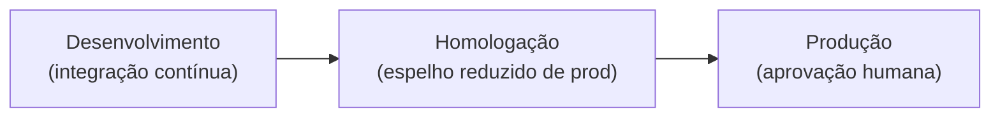
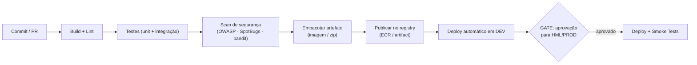

# Plano de Deploy — [Nome do Projeto]

<!--
  PLANO DE DEPLOY (DEPLOYMENT PLAN)
  Quando usar: antes de promover qualquer versão para homologação ou produção.
  Quem preenche: engenheiro-devops + Tech Lead; humano aprova o go-live.
  Regra de ouro: todo deploy deve ser AUTOMATIZADO, REVERSÍVEL e VERIFICÁVEL.
  Nada de deploy manual "no susto". Se não há rollback testado, não há deploy.
  Não confundir com o rollback de IMPLEMENTAÇÃO (IMPLEMENTATION_PLAN.md §6) —
  aqui tratamos do rollback de DEPLOY (artefato em produção).
-->

| Campo | Valor |
|---|---|
| **Projeto** | [Nome do Projeto] |
| **Versão do documento** | [0.1.0] |
| **Versão a ser implantada** | [vX.Y.Z] |
| **Data** | [AAAA-MM-DD] |
| **Autor(es)** | [Nome / Agente] |
| **Status** | [Rascunho \| Em revisão \| Aprovado \| Executado \| Revertido] |
| **Documentos base** | [ARCHITECTURE.md] · [TEST_PLAN.md] · [SECURITY_REVIEW.md] · [RELEASE_NOTES.md] |

---

## 1. Objetivo do Deploy

<!-- O que esta implantação entrega, em 1-2 frases. Vincule à RELEASE_NOTES da versão. -->

[Implantar a versão vX.Y.Z, que entrega as funcionalidades A e B, em produção até AAAA-MM-DD.]

## 2. Ambientes

<!-- Descreva a esteira de promoção. A versão sobe na ordem: dev → homologação → produção.
     Nunca pular ambiente sem justificativa registrada. -->

| Ambiente | Propósito | Infra de referência | Dados | Quem aprova promoção |
|---|---|---|---|---|
| Desenvolvimento | Validação contínua por PR | [ECS Fargate / Lambda — dev] | [sintéticos] | [automático no merge] |
| Homologação | Aceite, E2E e performance | [espelho reduzido de produção] | [anonimizados] | [Tech Lead / QA] |
| Produção | Operação real | [conforme ARCHITECTURE.md] | [reais] | [Sponsor / Tech Lead] |

## 3. Pipeline CI/CD

<!-- Descreva as etapas automatizadas. Toda etapa de qualidade que falha BLOQUEIA a promoção.
     Stack de referência: GitHub Actions. Adapte os jobs ao backend do projeto. -->

| Etapa | Ferramenta | Critério de sucesso | Bloqueante? |
|---|---|---|---|
| Build | [Maven / Gradle / uv / npm] | [build verde] | Sim |
| Lint / formatação | [Checkstyle / ruff / ng lint] | [zero erros] | Sim |
| Testes | [`mvn verify` + JaCoCo / `pytest --cov` / `ng test`] | [cobertura ≥ 80% código novo] | Sim |
| Segurança | [OWASP dependency-check / bandit / safety] | [sem vuln. 🔴 bloqueante] | Sim |
| Empacotamento | [Docker build / mvn package] | [artefato gerado e assinado] | Sim |
| Publicação | [ECR / GitHub Packages] | [tag imutável vX.Y.Z publicada] | Sim |

## 4. Estratégia de Deploy

<!-- Escolha UMA estratégia e justifique. Prefira a mais simples que atenda ao requisito
     de disponibilidade (P1-Simplicidade). Marque a escolhida. -->

| Estratégia | Quando usar | Trade-off |
|---|---|---|
| **Rolling** (padrão) | Serviços stateless, atualização gradual de instâncias | Simples; convivência temporária de duas versões |
| **Blue-Green** | Disponibilidade alta, rollback instantâneo necessário | Custo: dobra a infra durante a janela |
| **Canary** | Risco alto, validar com fatia pequena de tráfego | Complexidade de roteamento e observabilidade |

- **Estratégia escolhida:** [Rolling \| Blue-Green \| Canary]
- **Justificativa:** [ancorada em P1-Simplicidade > P2-Performance > P3-CustoBaixo e no requisito de disponibilidade do PRD.]
- **Compatibilidade de versões:** [API e schema retrocompatíveis durante a transição? Sim/Não — se não, exige janela.]

## 5. Pré-requisitos (Checklist Pré-Deploy)

<!-- Tudo isto DEVE estar verde antes de iniciar. Se um item falhar, o deploy não começa. -->

- [ ] Versão tagueada e artefato publicado no registry
- [ ] TEST_PLAN.md com gate aprovado (cobertura + E2E das jornadas críticas)
- [ ] SECURITY_REVIEW.md sem itens 🔴 bloqueantes
- [ ] RELEASE_NOTES.md da versão revisada (inclui breaking changes)
- [ ] Migrações de banco testadas em homologação (com rollback)
- [ ] Variáveis de ambiente e secrets configurados (sem segredos no código)
- [ ] Feature flags definidas (novidades arriscadas entram desligadas)
- [ ] Janela de manutenção comunicada aos stakeholders
- [ ] Backup/snapshot do estado atual realizado
- [ ] Responsáveis de plantão confirmados e disponíveis

## 6. Passos de Deploy

<!-- Sequência executável, idealmente automatizada via pipeline. Cada passo tem dono e verificação.
     Numere para facilitar referência na comunicação durante a janela. -->

| # | Passo | Comando / Ação | Responsável | Verificação |
|---|---|---|---|---|
| 1 | Congelar merges na branch de release | [proteção de branch] | [DevOps] | [branch protegida] |
| 2 | Aplicar migrações de banco | [Flyway/Alembic migrate] | [DevOps] | [migração sem erro; schema validado] |
| 3 | Promover artefato vX.Y.Z | [deploy via pipeline] | [DevOps] | [healthcheck verde nas instâncias] |
| 4 | Executar smoke tests | [ver §7] | [QA] | [todos os smokes passam] |
| 5 | Liberar tráfego / desligar canary | [ajuste de roteamento] | [DevOps] | [métricas estáveis por N min] |
| 6 | Ativar feature flags (se aplicável) | [toggle] | [Tech Lead] | [funcionalidade visível e estável] |

## 7. Smoke Tests Pós-Deploy

<!-- Verificações rápidas (minutos) que confirmam que o ambiente está SAUDÁVEL.
     Devem ser automatizadas sempre que possível. Falha aqui = candidato a rollback. -->

| ID | Verificação | Resultado esperado | Automatizado? |
|---|---|---|---|
| SM-001 | [GET /health] | [200 + status UP de dependências] | [Sim] |
| SM-002 | [Fluxo crítico ponta a ponta] | [resposta correta e persistência confirmada] | [Sim] |
| SM-003 | [Métricas e logs fluindo no observability] | [dashboards atualizando, sem pico de erro 5xx] | [Sim] |
| SM-004 | [Autenticação / autorização] | [acesso permitido/negado conforme RBAC] | [Sim] |

## 8. Plano de Rollback

<!-- Rollback do ARTEFATO em produção. Deve ser ensaiado em homologação antes do go-live.
     Defina o gatilho objetivo: qual métrica/situação dispara a reversão. -->

- **Gatilho de rollback:** [ex.: erro 5xx > 2% por 5 min, ou falha em SM-002, ou latência p95 > 2× baseline.]
- **Decisor do rollback:** [quem autoriza — Tech Lead / plantão.]
- **Tempo-alvo de reversão (RTO):** [ex.: < 10 min.]

| Cenário | Ação de rollback | Responsável | Cuidado especial |
|---|---|---|---|
| [Smoke test crítico falha] | [reverter para vX.Y.(Z-1) via pipeline] | [DevOps] | [verificar compatibilidade de schema] |
| [Migração de banco incompatível] | [restaurar snapshot pré-deploy / migração reversa] | [DevOps] | [janela de indisponibilidade de X min] |
| [Degradação após liberar tráfego] | [redirecionar para ambiente blue / reduzir canary a 0%] | [DevOps] | [comunicar stakeholders] |

## 9. Janela e Comunicação

<!-- Quando, por quanto tempo e quem precisa saber. Comunicação ANTES, DURANTE e DEPOIS. -->

| Item | Valor |
|---|---|
| **Data/hora de início** | [AAAA-MM-DD HH:MM TZ] |
| **Duração estimada** | [X min] |
| **Impacto esperado** | [zero downtime \| indisponibilidade de X min] |
| **Canal de coordenação** | [ex.: canal #deploy / war room] |

| Momento | Mensagem | Para quem | Responsável |
|---|---|---|---|
| Antes (D-1) | [aviso de janela e impacto] | [stakeholders / usuários] | [Tech Lead] |
| Início | [deploy iniciado] | [time / plantão] | [DevOps] |
| Fim (sucesso) | [versão em produção + destaques] | [stakeholders] | [Tech Lead] |
| Fim (rollback) | [reversão executada + causa] | [stakeholders / time] | [Tech Lead] |

## 10. Responsáveis e Plantão

| Papel | Nome / Agente | Responsabilidade durante o deploy |
|---|---|---|
| Líder do deploy | [nome] | [coordena a execução e decide rollback] |
| Executor DevOps | [nome] | [roda o pipeline e os passos de infra] |
| QA / smoke tests | [nome] | [valida pós-deploy] |
| Plantão (on-call) | [nome] | [responde a incidentes na janela e pós-janela] |

## 11. Aprovação de Go-Live

<!-- Agentes IA NÃO aprovam go-live de produção — somente humanos. -->

| Papel | Nome | Decisão | Data |
|---|---|---|---|
| Tech Lead | [nome] | [Aprovado / Pendente] | [AAAA-MM-DD] |
| Sponsor | [nome] | [Pendente] | [AAAA-MM-DD] |

---

## Histórico de Revisões

| Versão | Data | Autor | Mudança |
|---|---|---|---|
| 0.1.0 | [AAAA-MM-DD] | [autor] | Criação inicial |
