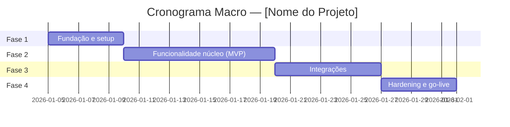

# Plano de Implementação — [Nome do Projeto]

<!--
  PLANO DE IMPLEMENTAÇÃO
  Quando usar: após PRD e ARCHITECTURE aprovados, antes de escrever código.
  Quem preenche: Tech Lead + agentes especialistas; humano aprova os checkpoints.
  Regra de ouro: fases pequenas com entregáveis VERIFICÁVEIS. Cada fase termina com
  algo funcionando (vertical slice), nunca com "80% pronto".
-->

| Campo | Valor |
|---|---|
| **Projeto** | [Nome do Projeto] |
| **Versão do documento** | [0.1.0] |
| **Data** | [AAAA-MM-DD] |
| **Autor(es)** | [Nome / Agente] |
| **Status** | [Rascunho \| Em revisão \| Aprovado \| Em execução \| Concluído] |
| **Documentos base** | [PRD.md] · [ARCHITECTURE.md] |

---

## 1. Objetivo

<!-- O que este plano entrega ao final, em 1-2 frases. Vincule aos objetivos do PRD. -->

[Entregar X, atendendo aos objetivos O1 e O2 do PRD, até AAAA-MM-DD.]

## 2. Visão Geral das Fases

<!-- 3 a 6 fases. Cada fase entrega valor verificável. Ajuste o Gantt à realidade. -->

| Fase | Nome | Entregável principal | Duração estimada |
|---|---|---|---|
| 1 | [Fundação] | [repo, CI/CD, esqueleto deployável em dev] | [X dias] |
| 2 | [Núcleo/MVP] | [fluxo principal funcionando ponta a ponta] | [X dias] |
| 3 | [Integrações] | [integrações X e Y operacionais] | [X dias] |
| 4 | [Hardening] | [segurança, performance, go-live] | [X dias] |

## 3. Detalhamento das Fases

<!-- Replique o bloco abaixo para cada fase. Tarefas: granularidade de 0,5 a 2 dias.
     Estimativas: use P (pequena ≤ 0,5d), M (média ≤ 1d), G (grande ≤ 2d).
     Tarefa maior que G deve ser quebrada. -->

### Fase 1 — [Nome da Fase]

**Objetivo da fase:** [o que estará funcionando ao final.]

| ID | Tarefa | Responsável | Estimativa | Depende de |
|---|---|---|---|---|
| T1.1 | [Criar repositório e pipeline CI] | [agente/humano] | [P] | — |
| T1.2 | [Esqueleto da API com health check] | [agente/humano] | [M] | T1.1 |
| T1.3 | [Provisionar infra base (IaC)] | [agente/humano] | [G] | T1.1 |

**Entregáveis:**
- [ ] [Entregável 1 — verificável: "pipeline verde no commit X"]
- [ ] [Entregável 2]

**Riscos da fase:**

| Risco | Prob. | Impacto | Mitigação |
|---|---|---|---|
| [acesso AWS não liberado a tempo] | [Média] | [Alto] | [solicitar na semana anterior] |

### Fase 2 — [Nome da Fase]

**Objetivo da fase:** [...]

| ID | Tarefa | Responsável | Estimativa | Depende de |
|---|---|---|---|---|
| T2.1 | [...] | [...] | [...] | [T1.2] |

**Entregáveis:**
- [ ] [...]

**Riscos da fase:**

| Risco | Prob. | Impacto | Mitigação |
|---|---|---|---|
| [...] | [...] | [...] | [...] |

<!-- Repita para Fases 3, 4... -->

## 4. Critérios de Pronto (Definition of Done)

<!-- DoD aplicável a TODA tarefa. Marque o que vale para este projeto e adicione específicos. -->

Uma tarefa só está PRONTA quando:

- [ ] Código revisado (tech-lead-review) e aprovado
- [ ] Testes unitários escritos e passando (cobertura conforme TEST_PLAN.md)
- [ ] Testes de integração dos fluxos afetados passando
- [ ] Sem vulnerabilidades 🔴 bloqueantes (SECURITY_REVIEW.md)
- [ ] Logs e métricas instrumentados nos novos fluxos
- [ ] Documentação atualizada (API_SPEC.md, README, etc.)
- [ ] Deploy em ambiente de desenvolvimento/homologação verificado
- [ ] [Critério específico do projeto]

## 5. Checkpoints de Aprovação Humana

<!-- Pontos onde agentes IA PARAM e aguardam validação humana. Obrigatórios em:
     fim de fase, mudança de escopo, decisão arquitetural nova e antes do go-live. -->

| Checkpoint | Quando | O que o humano valida | Aprovador |
|---|---|---|---|
| CP1 | Fim da Fase 1 | [infra e pipeline operacionais] | [nome] |
| CP2 | Fim da Fase 2 | [demo do fluxo principal] | [nome] |
| CP3 | Antes do go-live | [SECURITY_REVIEW + TEST_PLAN aprovados] | [nome] |

## 6. Plano de Rollback

<!-- Se algo der errado durante a implementação (não confundir com rollback de deploy —
     este está em DEPLOYMENT_PLAN.md). Como abandonar/reverter uma fase com segurança? -->

| Cenário | Ação de rollback | Responsável |
|---|---|---|
| [Fase 3 inviabilizada por integração externa] | [feature flag desliga integração; MVP segue sem ela] | [nome] |
| [Migração de dados falha] | [restaurar snapshot pré-migração; janela de X min] | [nome] |

## 7. Premissas e Restrições

<!-- O que assumimos como verdade para este plano valer. Se uma premissa cair, replanejar. -->

- **Premissas:** [equipe de X pessoas/agentes disponível; ambiente AWS provisionado até DD/MM]
- **Restrições:** [orçamento ≤ X; prazo regulatório em DD/MM; stack da Squad]

---

## Histórico de Revisões

| Versão | Data | Autor | Mudança |
|---|---|---|---|
| 0.1.0 | [AAAA-MM-DD] | [autor] | Criação inicial |
