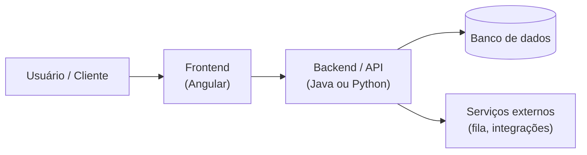

# Handoff de Projeto — [Nome do Projeto]

<!--
  PROJECT HANDOFF (PASSAGEM DE PROJETO)
  Quando usar: ao transferir um projeto/sistema para outro time, para sustentação,
  ou ao concluir um ciclo e documentar o estado para quem assume.
  Quem preenche: Tech Lead + agentes que construíram; quem recebe valida lendo e rodando local.
  Regra de ouro: quem recebe deve conseguir RODAR o sistema localmente seguindo só este doc.
  Se faltar um passo, o handoff está incompleto. Sem segredos em texto — aponte para o cofre.
-->

| Campo | Valor |
|---|---|
| **Projeto** | [Nome do Projeto] |
| **Versão do documento** | [0.1.0] |
| **Data do handoff** | [AAAA-MM-DD] |
| **De (entrega)** | [time/pessoa que entrega] |
| **Para (recebe)** | [time/pessoa que recebe] |
| **Status** | [Rascunho \| Em validação \| Concluído] |
| **Documentos base** | [PRD.md] · [ARCHITECTURE.md] · [DEPLOYMENT_PLAN.md] |

---

## 1. Visão Geral

<!-- O que é o sistema, para quem serve e que problema resolve. 2 a 4 frases.
     Quem nunca viu o projeto deve entender o propósito lendo só isto. -->

[O [Nome do Projeto] é um [tipo de sistema] que [resolve qual problema] para [qual público].]

## 2. Estado Atual

<!-- Onde o projeto está HOJE. Seja honesto sobre maturidade e o que está / não está em produção. -->

| Aspecto | Situação |
|---|---|
| **Maturidade** | [MVP \| Beta \| Produção \| Em sustentação] |
| **Versão em produção** | [vX.Y.Z desde AAAA-MM-DD] |
| **Cobertura de testes** | [X% — ver TEST_PLAN.md] |
| **Última auditoria de segurança** | [AAAA-MM-DD — ver SECURITY_REVIEW.md] |
| **Itens 🔴 bloqueantes abertos** | [nenhum \| listar] |

## 3. Como Rodar Localmente

<!-- O CORAÇÃO do handoff. Passo a passo testado, do zero ao sistema rodando.
     Use comandos PowerShell (ambiente Windows da Squad) e mencione o equivalente quando útil. -->

### Pré-requisitos

| Ferramenta | Versão | Como verificar |
|---|---|---|
| [Java] | [25] | [`java -version`] |
| [Python] | [3.13.5] | [`python --version`] |
| [Node] | [22] | [`node --version`] |
| [Docker] | [recente] | [`docker --version`] |

### Passos

```powershell
# 1. Clonar e entrar no repositório
git clone [url-do-repo]
Set-Location [pasta-do-repo]

# 2. Configurar variáveis de ambiente (copiar exemplo e preencher)
Copy-Item .env.example .env

# 3. Subir dependências (banco, fila) via Docker Compose
docker compose up -d

# 4. Instalar dependências e rodar a aplicação
[mvn spring-boot:run | uv run uvicorn app.main:app --reload | ng serve]

# 5. Validar
# Abrir http://localhost:[porta]/health  → deve retornar status UP
```

> **Segredos:** nunca commitados. Obtenha-os em [cofre/secret manager — ex.: AWS Secrets Manager] com [quem libera acesso].

## 4. Arquitetura Resumida

<!-- Diagrama de alto nível + 1 parágrafo. O detalhe completo fica em ARCHITECTURE.md. -->



[O frontend consome a API REST; a API persiste em [banco] e integra com [serviços]. Detalhes em ARCHITECTURE.md.]

| Componente | Tecnologia | Responsabilidade |
|---|---|---|
| Frontend | [Angular 21+] | [interface do usuário] |
| Backend | [Java 25 / Python 3.13.5] | [regras de negócio e API] |
| Persistência | [PostgreSQL / DynamoDB] | [armazenamento] |
| Infra | [AWS — ECS/Lambda] | [hospedagem e escalabilidade] |

## 5. Decisões Importantes

<!-- As decisões que quem assume PRECISA conhecer para não as reverter por engano.
     Aponte para os ADRs. Não repita o ADR inteiro — resuma o "porquê". -->

| Decisão | Resumo do porquê | ADR |
|---|---|---|
| [Monólito modular em vez de microsserviços] | [P1-Simplicidade; volume não justifica distribuição] | [ADR-001] |
| [PostgreSQL em vez de NoSQL] | [necessidade de transações e consultas relacionais] | [ADR-002] |

## 6. Dívidas Técnicas Conhecidas

<!-- Seja transparente. Dívida não documentada vira armadilha para quem assume. -->

| ID | Dívida | Impacto | Prioridade de quitação |
|---|---|---|---|
| DEBT-001 | [Cobertura de testes baixa no módulo de relatórios] | [refatorações arriscadas] | [Alta] |
| DEBT-002 | [Acoplamento entre serviço X e Y] | [mudança em um afeta o outro] | [Média] |

## 7. Pendências Abertas

<!-- O que ficou inacabado ou planejado mas não entregue. Diferente de dívida técnica:
     pendência é trabalho previsto que ainda falta fazer. -->

| ID | Pendência | Status | Onde está rastreado |
|---|---|---|---|
| PEND-001 | [Integração com gateway de pagamento B] | [não iniciada] | [backlog / issue #NN] |
| PEND-002 | [...] | [...] | [...] |

## 8. Operação e Observabilidade

<!-- Como quem assume opera o sistema no dia a dia. -->

| Item | Onde / Como |
|---|---|
| **Dashboards** | [link do Grafana / CloudWatch] |
| **Logs** | [onde consultar — ex.: CloudWatch Logs grupo X] |
| **Alertas** | [canal/ferramenta de alertas] |
| **Runbooks** | [link para procedimentos de incidente] |
| **Deploy** | [DEPLOYMENT_PLAN.md] |

## 9. Contatos e Links

<!-- Quem sabe das coisas e onde estão as coisas. -->

| Recurso | Link / Contato |
|---|---|
| Repositório | [url] |
| Documentação | [pasta docs/ ou wiki] |
| Board / backlog | [link] |
| Especialista do domínio | [nome / contato] |
| Sponsor / PO | [nome / contato] |
| Canal de suporte | [#canal] |

## 10. Próximos Passos Recomendados

<!-- O que quem assume deveria fazer PRIMEIRO. Ordene por prioridade. -->

1. [Rodar o sistema localmente seguindo a seção 3 e confirmar que tudo sobe.]
2. [Ler os ADRs principais (seção 5) antes de propor mudanças estruturais.]
3. [Atacar a dívida DEBT-001 antes da próxima evolução do módulo de relatórios.]
4. [Validar acessos: cofre de segredos, AWS, board, observabilidade.]

## 11. Aceite do Handoff

<!-- Só está concluído quando quem recebe RODA o sistema e confirma. -->

| Papel | Nome | Confirmação | Data |
|---|---|---|---|
| Entrega | [nome] | [Conteúdo validado] | [AAAA-MM-DD] |
| Recebe | [nome] | [Rodei localmente e entendi o estado: Sim/Não] | [AAAA-MM-DD] |

---

## Histórico de Revisões

| Versão | Data | Autor | Mudança |
|---|---|---|---|
| 0.1.0 | [AAAA-MM-DD] | [autor] | Criação inicial |
