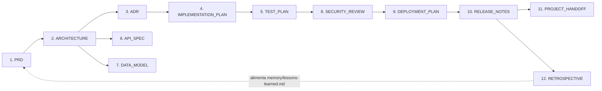

# Templates de Engenharia — Squad AI

<!--
  ÍNDICE DOS TEMPLATES
  Quem mantém: Tech Lead. Atualize esta tabela ao adicionar/remover um template.
  Como usar: copie o template para a pasta do projeto, preencha os [placeholders] e
  remova os comentários HTML de instrução antes de publicar a versão final.
  Princípios da Squad: P1-Simplicidade > P2-Performance > P3-CustoBaixo.
  Segurança nunca é negociável (vulnerabilidade crítica = 🔴 bloqueante).
-->

| Campo | Valor |
|---|---|
| **Versão do índice** | [0.1.0] |
| **Data** | 2026-06-12 |
| **Mantenedor** | Tech Lead da Squad |
| **Total de templates** | 13 |

---

## Os 13 templates

| # | Template | Quando usar |
|---|---|---|
| 1 | [PRD.md](./PRD.md) | No início do projeto/feature: descreve o problema, personas e objetivos mensuráveis — antes da arquitetura. |
| 2 | [ARCHITECTURE.md](./ARCHITECTURE.md) | Após o PRD: registra a arquitetura da solução, componentes, fluxos e requisitos não-funcionais. |
| 3 | [ADR.md](./ADR.md) | A cada decisão arquitetural difícil de reverter (banco, framework, estratégia de deploy). |
| 4 | [IMPLEMENTATION_PLAN.md](./IMPLEMENTATION_PLAN.md) | Antes de codar: quebra o trabalho em fases verificáveis com checkpoints de aprovação humana. |
| 5 | [TEST_PLAN.md](./TEST_PLAN.md) | Junto ao plano de implementação: define estratégia de testes, cobertura e gate de aprovação. |
| 6 | [API_SPEC.md](./API_SPEC.md) | Ao projetar ou expor uma API: contrato de endpoints, payloads, erros e versionamento. |
| 7 | [DATA_MODEL.md](./DATA_MODEL.md) | Ao modelar a persistência: entidades, relacionamentos, índices e estratégia de migração. |
| 8 | [SECURITY_REVIEW.md](./SECURITY_REVIEW.md) | Antes do go-live e ao tocar auth/dados sensíveis: auditoria OWASP/LGPD e itens bloqueantes. |
| 9 | [DEPLOYMENT_PLAN.md](./DEPLOYMENT_PLAN.md) | Antes de promover uma versão: ambientes, pipeline, estratégia, smoke tests e rollback. |
| 10 | [RELEASE_NOTES.md](./RELEASE_NOTES.md) | A cada release: versão semver, destaques, novidades, breaking changes e problemas conhecidos. |
| 11 | [PROJECT_HANDOFF.md](./PROJECT_HANDOFF.md) | Ao transferir o projeto para sustentação/outro time: como rodar, decisões, dívidas e pendências. |
| 12 | [RETROSPECTIVE.md](./RETROSPECTIVE.md) | Ao fim de um ciclo/release: o que melhorar, métricas e lições para a memória da Squad. |
| 13 | [cognitive-context-pack.md](./cognitive-context-pack.md) | Em automacoes cognitivas recorrentes: registra fontes, memorias, decisoes, gates, validacoes e backlog. |

## Onde cada template entra no ciclo

## Convenções comuns a todos os templates

- **Bloco de metadados** no topo: projeto, versão, data, autor(es), status.
- **Placeholders** entre colchetes: `[assim]` — substitua todos antes de publicar.
- **Instruções** em comentários HTML (`<!-- ... -->`): remova-as na versão final.
- **Datas** no formato `AAAA-MM-DD`; **versões** em [SemVer](https://semver.org) (`MAJOR.MINOR.PATCH`).
- **Aprovações** são sempre de humanos — agentes de IA preenchem, mas não aprovam marcos críticos.
- **Histórico de revisões** ao final de cada documento.

---

## Histórico de Revisões

| Versão | Data | Autor | Mudança |
|---|---|---|---|
| 0.1.0 | 2026-06-12 | Tech Lead da Squad | Criação do índice com os 12 templates |
