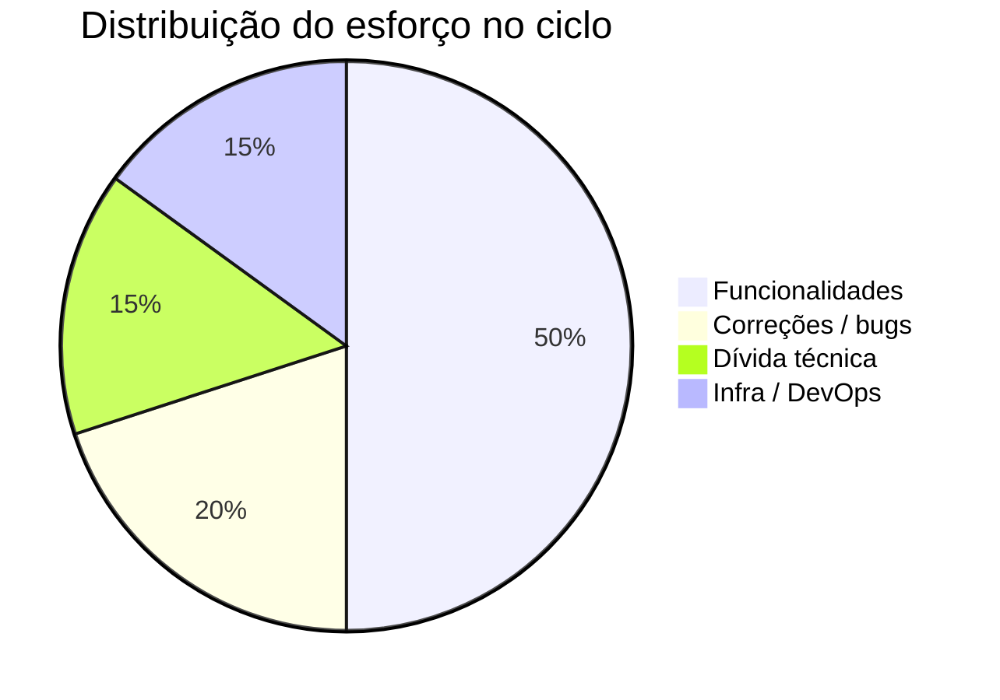

# Retrospectiva — [Nome do Projeto / Ciclo]

<!--
  RETROSPECTIVE (RETROSPECTIVA)
  Quando usar: ao fim de cada ciclo, marco ou release relevante.
  Quem preenche: Tech Lead conduz; toda a squad (humanos e agentes) contribui.
  Regra de ouro: foco em PROCESSO e APRENDIZADO, não em culpa. Toda ação tem dono e prazo.
  Saída-chave: a seção "Lições para a memória da Squad" alimenta memory/lessons-learned.md —
  preencha-a no formato pronto para colar, sem reescrever.
-->

| Campo | Valor |
|---|---|
| **Projeto / Ciclo** | [Nome do Projeto — Ciclo/Sprint N] |
| **Versão do documento** | [0.1.0] |
| **Data da retrospectiva** | [AAAA-MM-DD] |
| **Período avaliado** | [AAAA-MM-DD a AAAA-MM-DD] |
| **Facilitador** | [Tech Lead / Agente] |
| **Participantes** | [lista de pessoas/agentes] |
| **Status** | [Rascunho \| Concluída] |

---

## 1. Contexto do Ciclo

<!-- 1 a 3 frases: o que era o objetivo deste ciclo e se foi atingido. -->

[O objetivo do ciclo era entregar X. Resultado: atingido / parcialmente atingido / não atingido — porque Y.]

## 2. O que foi bem (Keep)

<!-- Práticas e resultados que devemos MANTER. Seja específico — "comunicação boa" não ajuda;
     "o daily de 10min destravou 3 bloqueios na hora" ajuda. -->

| # | O que foi bem | Por que funcionou |
|---|---|---|
| K1 | [Adoção do gate de testes no CI] | [pegou 4 regressões antes do merge] |
| K2 | [...] | [...] |

## 3. O que melhorar (Improve)

<!-- O que não foi ideal. Descreva o FATO observável, não a pessoa. -->

| # | O que melhorar | Impacto observado |
|---|---|---|
| I1 | [Estimativas otimistas demais na Fase 2] | [atraso de 3 dias no marco] |
| I2 | [...] | [...] |

## 4. O que aprendemos (Lessons)

<!-- Aprendizados que mudam como trabalhamos. Cada lição deve ser ACIONÁVEL no futuro. -->

| # | Aprendizado | Como aplicar daqui pra frente |
|---|---|---|
| L1 | [Testcontainers desde a Fase 1 evita surpresa de integração no fim] | [incluir no IMPLEMENTATION_PLAN da próxima] |
| L2 | [...] | [...] |

## 5. Métricas do Ciclo

<!-- Dados objetivos. Comparar planejado vs. realizado expõe padrões de estimativa.
     Preencha apenas as métricas que o projeto realmente coleta. -->

| Métrica | Planejado | Realizado | Observação |
|---|---|---|---|
| Itens entregues | [N] | [N] | [...] |
| Prazo (dias) | [N] | [N] | [...] |
| Cobertura de testes | [meta %] | [% real] | [TEST_PLAN.md] |
| Bugs em produção pós-release | [meta] | [N] | [...] |
| Lead time médio (commit → produção) | [meta] | [real] | [...] |
| Vulnerabilidades 🔴 introduzidas | [0] | [N] | [SECURITY_REVIEW.md] |



## 6. Plano de Ações

<!-- A retro só vale se gerar AÇÃO. Toda ação tem dono e prazo. Sem dono, não é ação — é desejo.
     Revise estas ações no início da próxima retro. -->

| ID | Ação | Origem | Responsável | Prazo | Status |
|---|---|---|---|---|---|
| A1 | [Adotar buffer de 20% nas estimativas de fases longas] | [I1] | [nome] | [AAAA-MM-DD] | [Aberta] |
| A2 | [Criar runbook de rollback e ensaiar em HML] | [L1] | [nome] | [AAAA-MM-DD] | [Aberta] |

## 7. Lições para a memória da Squad

<!--
  SEÇÃO-CHAVE. Conteúdo pronto para alimentar memory/lessons-learned.md.
  Formato atômico inspirado nos "instintos" da Squad: cada lição é autocontida.
  Campos:
    - lição     : a regra aprendida, em uma frase imperativa.
    - gatilho   : a situação em que a lição se aplica (quando lembrar dela).
    - confiança : 0.3 a 0.9 — quão forte é a evidência (0.9 = comprovada várias vezes).
    - domínio   : área (testes, arquitetura, deploy, segurança, estimativa, processo...).
    - escopo    : projeto | global (global = vale para toda a Squad).
    - evidência : o fato concreto deste ciclo que justifica a lição.
  Copie os blocos abaixo direto para memory/lessons-learned.md.
-->

```yaml
- licao: "Provisionar infra real (Testcontainers) desde a Fase 1, não no fim."
  gatilho: "ao planejar fases de um projeto com integrações (banco, fila, cache)"
  confianca: 0.8
  dominio: testes
  escopo: global
  evidencia: "Integração com SQS só foi testada na Fase 4 e revelou config de DLQ errada, custando 2 dias."

- licao: "[Lição 2 em uma frase imperativa]"
  gatilho: "[quando esta lição se aplica]"
  confianca: 0.6
  dominio: "[arquitetura | deploy | seguranca | estimativa | processo]"
  escopo: "[projeto | global]"
  evidencia: "[fato concreto deste ciclo]"
```

> **Como incorporar:** anexe os blocos acima a `memory/lessons-learned.md`. Mantenha o índice atualizado e mescle lições duplicadas (ex.: via `/consolidate-memory`).

## 8. Reconhecimentos

<!-- Opcional. Destaques individuais ou de time que merecem registro. -->

- [Nome / Agente — pelo quê]

---

## Histórico de Revisões

| Versão | Data | Autor | Mudança |
|---|---|---|---|
| 0.1.0 | [AAAA-MM-DD] | [autor] | Criação inicial |
