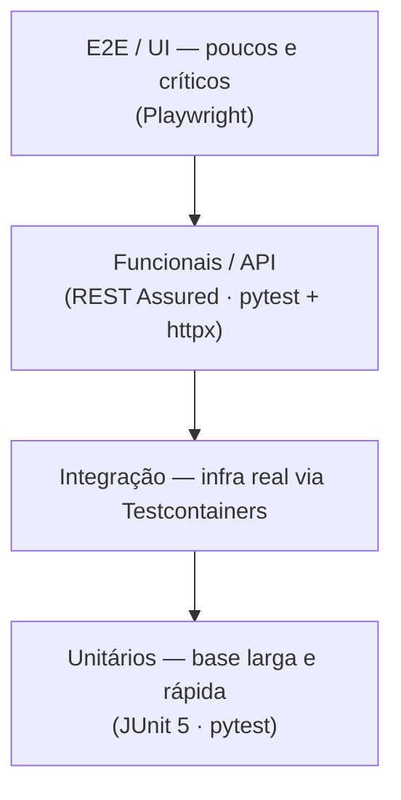

# Plano de Testes — [Nome do Projeto]

<!--
  PLANO DE TESTES
  Quando usar: junto com o plano de implementação — testes se planejam ANTES do código.
  Quem preenche: especialista-qualidade; Tech Lead aprova o gate.
  Regra de ouro: siga a pirâmide (muitos unitários, alguns de integração, poucos E2E).
  Todo cenário deve ser automatizável; teste manual é exceção justificada.
-->

| Campo | Valor |
|---|---|
| **Projeto** | [Nome do Projeto] |
| **Versão do documento** | [0.1.0] |
| **Data** | [AAAA-MM-DD] |
| **Autor(es)** | [Nome / Agente] |
| **Status** | [Rascunho \| Em revisão \| Aprovado] |
| **Documentos base** | [PRD.md] · [ARCHITECTURE.md] |

---

## 1. Estratégia (Pirâmide de Testes)

<!-- Defina a proporção-alvo e a ferramenta de cada camada. Ajuste à stack do projeto. -->

| Camada | Proporção-alvo | Ferramentas (Java / Python / Frontend) | Tempo máx. da suíte |
|---|---|---|---|
| Unitários | [~70%] | [JUnit 5 + Mockito / pytest / Jest-Vitest] | [< 2 min] |
| Integração | [~20%] | [Testcontainers / pytest + Testcontainers] | [< 8 min] |
| Funcionais/API | [~8%] | [REST Assured / httpx + pytest-bdd] | [< 10 min] |
| E2E | [~2%] | [Playwright] | [< 15 min] |

## 2. Escopo

### Dentro do escopo

- [Fluxo/módulo 1 — ex.: criação e consulta de pedidos]
- [Fluxo/módulo 2]

### Fora do escopo

<!-- Liste o que NÃO será testado e por quê (ex.: sistema legado de terceiro). -->

- [Item — motivo]

## 3. Testes Unitários

<!-- Foco: regras de negócio puras, sem I/O. Mock apenas nas bordas. -->

- **Convenção de nomes:** [`deve_<resultado>_quando_<condicao>`]
- **O que SEMPRE cobrir:** regras de negócio, validações, cálculos, mapeamentos, branches de erro
- **O que NÃO testar unitariamente:** getters/setters, framework, configuração

| Módulo/Classe | Cenários-chave | Prioridade |
|---|---|---|
| [ServicoPedido] | [criação válida, valor negativo, item duplicado] | [Alta] |
| [...] | [...] | [...] |

## 4. Testes de Integração

<!-- Infra REAL via Testcontainers (banco, fila, cache). Nada de H2 fingindo PostgreSQL. -->

| Integração | O que validar | Ferramenta |
|---|---|---|
| [API ↔ PostgreSQL] | [persistência, constraints, migrações Flyway/Alembic] | [Testcontainers] |
| [API ↔ SQS] | [publicação, consumo, DLQ] | [LocalStack/Testcontainers] |
| [API ↔ Sistema externo X] | [contrato, timeout, retry] | [WireMock] |

## 5. Testes Funcionais e E2E

<!-- Funcionais: comportamento via API (caixa-preta). E2E: jornada completa do usuário,
     incluindo Docker Compose com healthchecks, frontend, backend e banco. -->

### Funcionais (API)

| ID | Cenário (Gherkin resumido) | Prioridade |
|---|---|---|
| F-001 | [Dado usuário autenticado, quando POST /pedidos válido, então 201 + pedido persistido] | [Alta] |
| F-002 | [Dado payload inválido, quando POST /pedidos, então 400 com erro RFC 7807] | [Alta] |

### E2E (jornadas críticas)

| ID | Jornada | Passos macro |
|---|---|---|
| E2E-001 | [Compra completa] | [login → busca → carrinho → pagamento → confirmação no banco] |

## 6. Cenários Preditivos de Erro

<!-- Antecipe falhas ANTES que ocorram em produção. Para cada categoria, defina o
     comportamento ESPERADO do sistema — não apenas "não quebrar". -->

| Categoria | Cenário | Comportamento esperado |
|---|---|---|
| Entrada | [payload nulo, campos extremos, encoding inválido, injection] | [400 estruturado, sem stack trace exposto] |
| Concorrência | [duas requisições simultâneas no mesmo recurso] | [lock otimista / idempotência — sem duplicidade] |
| Dependência externa | [timeout, 500, resposta malformada do sistema X] | [retry com backoff, circuit breaker, fallback definido] |
| Infraestrutura | [banco indisponível, fila cheia, disco cheio] | [erro 503, alerta disparado, sem perda de dados] |
| Estado | [reprocessamento de evento já consumido] | [idempotente — efeito único] |

## 7. Testes de Performance

<!-- Só faz sentido com SLO definido (ver ARCHITECTURE.md §8.3). Ferramenta: k6 (padrão). -->

| Tipo | Objetivo | Carga | Critério de aprovação |
|---|---|---|---|
| Load | [comportamento sob carga esperada] | [X req/s por 10 min] | [p95 < Yms, erro < 0,1%] |
| Stress | [encontrar o limite] | [rampa até falhar] | [degradação graciosa, recuperação pós-pico] |
| Soak | [vazamentos e degradação] | [carga média por 2h+] | [memória/latência estáveis] |
| Spike | [picos repentinos] | [0 → Nx em segundos] | [auto-scaling responde em < X min] |

## 8. Dados de Teste

<!-- NUNCA usar dados reais de produção sem anonimização (LGPD). -->

- **Origem:** [factories/builders no código; massa sintética gerada]
- **Dados sensíveis:** [proibido dado real; CPF/e-mail gerados artificialmente]
- **Reset entre testes:** [transação com rollback / truncate / container novo]

## 9. Ambientes

| Ambiente | Uso | Infra | Dados |
|---|---|---|---|
| Local | unitários + integração | [Docker Compose + Testcontainers] | [sintéticos] |
| CI | suíte completa por PR | [GitHub Actions + Testcontainers] | [sintéticos] |
| Homologação | E2E + performance | [espelho reduzido de produção] | [anonimizados] |

## 10. Critérios de Cobertura e Gate de Aprovação

<!-- O gate BLOQUEIA o merge/deploy. Sem exceções não documentadas. -->

| Critério | Meta | Bloqueante? |
|---|---|---|
| Cobertura de linhas (código novo) | [≥ 80%] | [Sim] |
| Cobertura de branches (regras críticas) | [≥ 90%] | [Sim] |
| Testes de integração dos fluxos alterados | [100% passando] | [Sim] |
| E2E das jornadas críticas | [100% passando] | [Sim] |
| Performance dentro do SLO | [conforme §7] | [Sim, para release] |
| Mutation score (módulos críticos) | [≥ 70%] | [Não — informativo] |

**Aprovação do gate:** [especialista-qualidade valida + Tech Lead aprova] em [AAAA-MM-DD].

---

## Histórico de Revisões

| Versão | Data | Autor | Mudança |
|---|---|---|---|
| 0.1.0 | [AAAA-MM-DD] | [autor] | Criação inicial |
